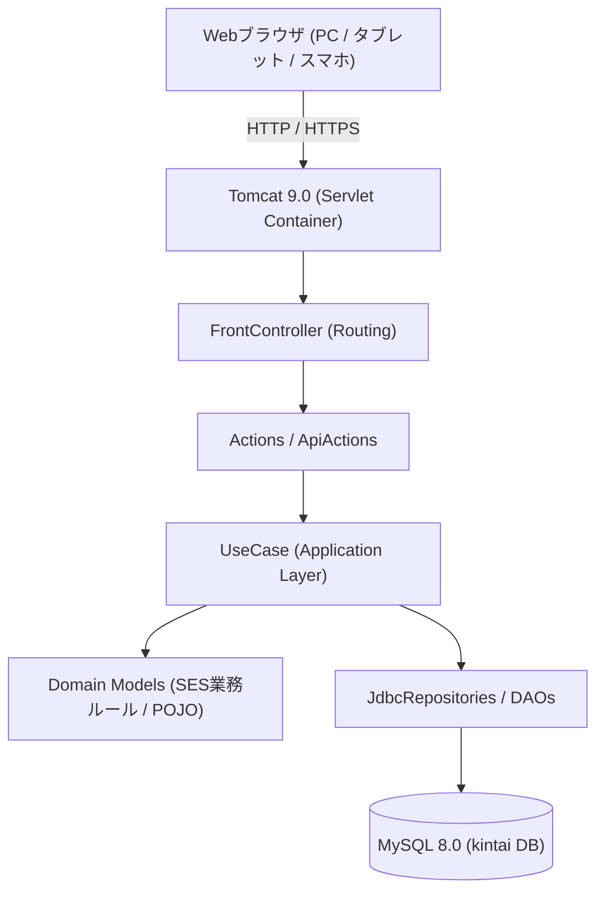

# SES勤怠管理・勤務報告書システム 要件定義書インデックス

## 📋 ドキュメント概要

本ドキュメント群は、Java 11 / Servlet / JSP / MySQL をベースとした「SES勤怠管理・勤務報告書システム」の設計書・要件定義書およびアーキテクチャ解説書です。

---

## 📁 ドキュメント構成一覧

| ファイル名 | 分類 | 概要 |
| :--- | :--- | :--- |
| [01_システム概要書.md](01_システム概要書.md) | システム全体概要 | システムの目的、対象範囲、SES特有の課題解決 |
| [02_機能要件定義書.md](02_機能要件定義書.md) | 機能仕様詳細 | 社員管理、SES勤怠、精算計算、コンプライアンス、週報 |
| [03_非機能要件定義書.md](03_非機能要件定義書.md) | 性能・品質要件 | 性能、可用性、セキュリティ、MySQL 8.0/Tomcat 9.0環境 |
| [04_画面設計書.md](04_画面設計書.md) | UI/UX設計 | Tailwind CSS採用の各画面レイアウトと操作仕様 |
| [05_データ定義書.md](05_データ定義書.md) | データベース設計 | 基本テーブル（社員・勤怠・有給）およびSES拡張テーブル定義 |
| [06_リファクタリング提案書.md](06_リファクタリング提案書.md) | 設計進化の記録 | 古典的Servlet/JSPからヘキサゴナル移行への変遷 |
| [07_新アーキテクチャ設計書.md](07_新アーキテクチャ設計書.md) | アーキテクチャ設計 | 4層クリーン構造、ドメイン保護、トランザクション管理 |
| [08_オンボーディングガイド.md](08_オンボーディングガイド.md) | 参画者向け手順書 | 3ステップ環境構築、動作確認、テスト実行、アカウント一覧 |
| [09_MVCからの設計転換ガイド.md](09_MVCからの設計転換ガイド.md) | 設計転換ガイド | MVCからヘキサゴナルへの発想転換、実装比較 |
| [10_アーキテクチャ設計思想と開発の考え方.md](10_アーキテクチャ設計思想と開発の考え方.md) | 設計思想・開発指針 | 自己防衛ドメイン、レイヤー依存則、実装判断フロー |
| [11_SESドメイン業務ルール解説書.md](11_SESドメイン業務ルール解説書.md) | ドメイン業務仕様 | 精算幅（上下限）、36協定4段階判定、中抜け休憩、週報 |

---

## 🎯 システム概要

### 主要機能群
1. **社員・組織管理**
   - 社員CRUD（一覧・登録・更新・削除）
   - 役職・ロールに応じた権限制御（一般社員 / マネージャー / 管理者）
2. **SES日次勤怠管理**
   - 出退勤時刻・中抜け休憩・作業セグメント（直接／間接作業）入力
   - 月間勤務テンプレート一括適用（祝日・所定休日の自動判定）
   - リアルタイム稼働時間・残業時間の自動算出
3. **SES契約・精算計算**
   - 案件別精算幅（下限〜上限時間）に基づく精算判定（過剰・控除・精算幅内）
   - 超過単価・控除単価に基づく精算額の自動計算
4. **労務コンプライアンス管理**
   - 36協定残業時間チェック（NORMAL / WARNING / DANGER / VIOLATION の4段階警告）
   - 労働基準法に基づく年5日有給休暇取得義務の遵守状況チェック
5. **有給休暇管理**
   - 勤続年数に応じた自動付与ルール設定・一括付与
   - 残日数管理と消化履歴追跡
6. **週報・レビューワークフロー**
   - 週次作業報告書（作業進捗・本人所感・負荷・体調スコア）提出
   - 上司／管理職によるレビューコメントとメンタルヘルス・エスカレーション判定

### 技術スタック
- **言語**: Java 11
- **フレームワーク**: 自作 FrontController + Commandパターン（フレームワーク非依存）
- **Web仕様**: Servlet 4.0, JSP 2.3, JSTL 1.2
- **UI / CSS**: Tailwind CSS, Vanilla JavaScript (Fetch API)
- **データベース**: MySQL 8.0 (InnoDB / utf8mb4)
- **アプリケーションサーバー**: Apache Tomcat 9.0
- **ビルドツール**: Apache Maven
- **テスト**: JUnit 5

---

## 📊 システム構成図

---

## 🔐 セキュリティ・権限管理

- **認証方式**: Sessionベース認証（`LoginAction`, `UserSession`）
- **ロール別認可**:
  - `USER`: 自身の勤怠入力・週報提出
  - `MANAGER`: 配下社員の勤怠・週報レビュー、精算サマリ確認
  - `ADMIN`: 社員CRUD、有給付与ルール設定、全社集計