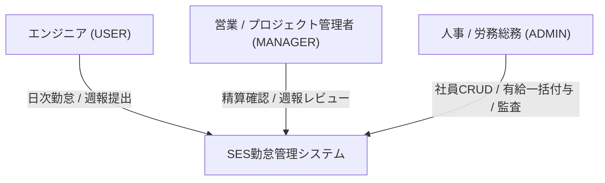
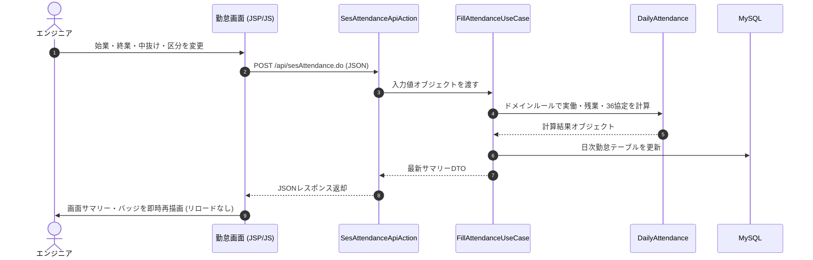

# SES勤怠管理・勤務報告書システム システム概要・企画背景書

## 1. システム名称および基本情報

- **システム名称**: SES勤怠管理・勤務報告書システム（SES Attendance & Work Reporting System）
- **プロジェクトコード**: Dev-lab
- **対象バージョン**: 2.0.0 (Hexagonal Clean Architecture Release)
- **開発運用形態**: 社内Webアプリケーション（イントラネット／クラウドデプロイ両対応）

---

## 2. 企画背景と業界課題

SES（システムエンジニアリングサービス）業界および準委任契約に基づくIT開発現場では、一般企業とは異なる特有の雇用・就業形態が存在します。エンジニアは自社ではなくクライアント企業に常駐（または客先リモート勤務）するため、労務管理・請求管理において以下の深刻な課題を抱えています。

### 2.1 課題1: 契約精算幅（上下限時間）に基づく請求計算の属人化
- SESの準委任契約では、月間稼働時間に応じた「精算幅（例: 140時間〜180時間）」が案件ごとに定められます。
- 140時間未満の場合は「控除」、180時間超過の場合は「超過精算」が発生し、それぞれ異なる精算単価（契約金額 ÷ 中間時間等）で計算する必要があります。
- 従来はExcelマクロや手動計算に頼っており、毎月末に営業・経理部門で莫大な突合工数が発生し、請求ミスやトラブルのリスクが常態化していました。

### 2.2 課題2: 労働基準法コンプライアンス（36協定・年5日有給取得義務）の予兆検知遅延
- 客先常駐エンジニアは、客先の繁忙期やリリース前夜に突発的な残業が発生しやすい環境にあります。
- 36協定の限度時間（月45時間、特別条項発動時でも月80時間未満）や、年間5日の有給休暇取得義務（労基法第39条第7項）に対し、月末に集計して初めて「違反していた」と判明するケースが散見されました。
- リアルタイムで残業の進捗度合いを監視し、危険域に達する前にアラートを出す仕組みが不可欠でした。

### 2.3 課題3: 客先常駐によるエンジニアの孤立と心身不調の早期検知困難
- 自社上司と日常的に顔を合わせないため、業務負荷の激増、人間関係のトラブル、メンタルヘルスの悪化が潜在化しやすい課題があります。
- 従来の「単なる出退勤打刻」では現場の状況が把握できず、離職や休職に至る前に兆候を捉えるための「週次の負荷・健康モニタリング（週報）」が強く求められていました。

### 2.4 課題4: 勤怠入力の煩雑さと提出遅延
- 客先の就業ルールに応じた「固定休憩時間」「通院等の中抜け休憩」「客先間接時間（自社研修や移動）」など、複雑な入力項目が存在します。
- これらを毎日1から手入力させると入力漏れ・月末集中が発生するため、「月間勤務テンプレート」によるワンクリック一括初期化と、差分のみを修正する運用が必要でした。

---

## 3. システムの目的と達成目標 (KPI)

| 目標分類 | 目標内容 | 導入前（従来） | 導入後（目標値） |
| :--- | :--- | :--- | :--- |
| **定量的目標** | 月末の精算計算・勤怠集計所要時間 | 1人あたり約30分/月 | **1人あたり5分未満（80%削減）** |
| | 36協定上限超過・労基法違反件数 | 年間数件の超過予備軍 | **0件（リアルタイム段階警告による未然防止）** |
| | 週報提出完了率（翌週月曜正午時点） | 65% | **95%以上（テンプレート＋スコア入力）** |
| | 有給休暇年間5日未取得リスク者 | 期末に慌てて有給消化指導 | **期中自動検知により期末残0名** |
| **定性的目標** | エンジニアの就業安全性の向上 | 孤立感・過重労働の潜在化 | **健康スコアと所感コメントによる迅速なフォロー** |
| | システム保守性・開発生産性 | Fat Controllerによる改修困難 | **ヘキサゴナル構造による完全独立テスト・高速保守** |

---

## 4. 対象ユーザーペルソナと利用シーン

### 4.1 一般エンジニア (ロール: `USER`)
- **利用シーン**: 毎日の業務終了時、または週末。
- **主な行動**:
  - 月初に「月間テンプレート適用」を行い、当月の平日すべてに標準時間（09:00〜18:00）を一括設定。
  - 残業や中抜け、有給取得があった日のみ、該当行の時刻・区分を変更して非同期保存。
  - 週末に作業内容、進捗、負荷スコア（1〜5）、健康スコア（1〜5）を入力して週報を提出。

### 4.2 営業 / プロジェクト管理者 (ロール: `MANAGER`)
- **利用シーン**: 週初（月曜日）および月末締め処理時。
- **主な行動**:
  - 担当エンジニアの月間総稼働時間が契約精算幅（下限〜上限）に収まっているかサマリー画面で確認。
  - 提出された週報の健康スコアやエスカレーションフラグを確認し、必要に応じて現場状況のヒアリングやレビューコメントを記録。

### 4.3 人事・労務総務 (ロール: `ADMIN`)
- **利用シーン**: 社員入退社時、有給付与基準日、月次締め後。
- **主な行動**:
  - 社員マスタの登録・変更・削除。
  - 勤続年数に基づく有給休暇の一括自動付与を実行。
  - 全社的な36協定残業警告レベルおよび年5日有給取得義務の進捗を監査。

---

## 5. 業務サイクルとシステム化フロー

### 5.1 月次サイクル
1. **月初**: エンジニアが当月の月間テンプレートを適用（営業日への標準時間自動入力）。
2. **日次**: 実際の出退勤、中抜け、適用区分（有給等）の差分更新。
3. **週次**: 週報提出（進捗・所感・スコア）と管理者によるレビュー。
4. **月末**: エンジニアによる最終実績確認と月次サマリー確定。
5. **月次締め**: 管理者による精算計算（過不足精算額確定）および労基チェック完了。

### 5.2 日次勤怠入力フロー

---

## 6. 技術スタック選定理由

| 技術選定 | 採用技術 | 選定理由・背景 |
| :--- | :--- | :--- |
| **実行基盤** | Java 11 (LTS) / Apache Tomcat 9.0 | 長期サポートの安定性、エンタープライズ現場での高い普及率、堅牢な型システム。 |
| **Web仕様** | Jakarta EE (Servlet 4.0, JSP 2.3, JSTL 1.2) | Spring Bootなどの大型フレームワークのブラックボックスを排除し、Webの基本原理を学ぶため。 |
| **アーキテクチャ** | ヘキサゴナル／クリーンアーキテクチャ | ドメイン（精算計算・労基判定）をDBやServletから100%独立させ、超高速なJUnit 5単体テストを実現するため。 |
| **データベース** | MySQL 8.0 (InnoDB / utf8mb4) | ACIDトランザクションの確実性、Unicode完全対応、JNDIコネクションプールによる安定稼働。 |
| **フロントエンド** | Tailwind CSS + Vanilla JS (Fetch API) | 外部UIライブラリに頼らず、モダンで軽量なレスポンシブデザインと非同期通信を実現するため。 |
| **ビルド / テスト** | Apache Maven / JUnit 5 | 標準化された依存管理と、ドメイン層のモック不要な高速単体テストの自動実行。 |
