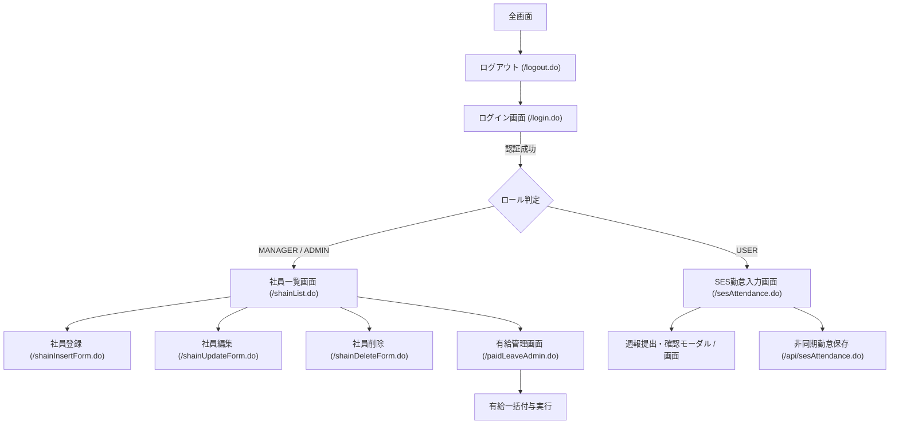

# SES勤怠管理・勤務報告書システム要件定義書
## 02. 機能要件定義書

### 2.1 機能一覧

| 機能群 | 機能ID | 機能名 | 概要 | 担当レイヤー (UseCase / Domain) |
| :--- | :--- | :--- | :--- | :--- |
| **認証・認可** | F-AUTH-01 | ログイン・セッション管理 | 社員ID・PW検証、セッション保持 | `LoginExecuteAction`, `UserSession` |
| | F-AUTH-02 | ロール認可制御 | USER / MANAGER / ADMIN の権限制御 | `domain.auth.UserRole` |
| | F-AUTH-03 | ログアウト | セッション破棄・安全な終了 | `LogoutAction` |
| **社員管理** | F-SHAIN-01 | 社員一覧表示 | 役職・有給残日数を含む全社員一覧 | `ShainListAction`, `ShainService` |
| | F-SHAIN-02 | 社員新規登録 | 社員情報・ログインアカウントの登録 | `ShainInsertExecuteAction`, `ShainService` |
| | F-SHAIN-03 | 社員情報更新 | 氏名・役職・有給日数等の変更 | `ShainUpdateExecuteAction`, `ShainService` |
| | F-SHAIN-04 | 社員削除 | 社員情報および関連アカウントの削除 | `ShainDeleteExecuteAction`, `ShainService` |
| **SES勤怠管理** | F-ATT-01 | SES日次勤怠入力・保存 | 出退勤、休憩、中抜け、摘要区分の登録 | `SesAttendanceAction`, `SesAttendanceApiAction`, `FillAttendanceUseCase` |
| | F-ATT-02 | 月間テンプレート一括適用 | 営業日の標準時間・休日の一括設定 | `ApplyMonthlyTemplateUseCase`, `AttendanceTemplateService` |
| | F-ATT-03 | 作業明細セグメント管理 | 直接作業／間接作業時間の分割記録 | `WorkTimeSegment`, `WorkCategory` |
| | F-ATT-04 | 月次稼働サマリ集計 | 総稼働、直接/間接、実働、残業の自動計算 | `domain.attendance.DailyAttendance`, `MonthlySummary` |
| **契約精算** | F-CON-01 | SES精算判定・金額算出 | 基準時間・精算幅・単価から精算額計算 | `CalculateSettlementUseCase`, `SettlementService` |
| **コンプライアンス** | F-COMP-01 | 36協定残業警告判定 | NORMAL / WARNING / DANGER / VIOLATION の4段階チェック | `Article36ComplianceService`, `OvertimeLevel` |
| | F-COMP-02 | 年5日有給取得義務判定 | 基準日からの年5日有給消化状況監視 | `PaidLeaveComplianceService` |
| **有給休暇管理** | F-LEAVE-01 | 有給残日数・増減管理 | 日常の有給消化、手動日数調整 | `LeaveService`, `LeaveDao` |
| | F-LEAVE-02 | 有給付与ルール設定 | 勤続年数（0.5年〜6.5年以上）ごとの付与日数管理 | `domain.shain.LeaveGrantRule` |
| | F-LEAVE-03 | 有給一括付与実行 | 社員の入社年から勤続年数を計算し一括付与 | `PaidLeaveAdminAction`, `LeaveService` |
| **週報管理** | F-REP-01 | 週報作成・提出 | 工程・作業内容・本人所感・スコア入力 | `SubmitWeeklyReportUseCase`, `WeeklyReport` |
| | F-REP-02 | メンタル・負荷監視 | 負荷度・健康度（1〜5）とエスカレーション判定 | `domain.weeklyreport.WeeklyReport` |
| | F-REP-03 | 週報レビュー・コメント | 管理職による承認・差戻し、コメント記録 | `ReviewWeeklyReportUseCase`, `WeeklyReportComment` |

---

## 2.2 詳細機能仕様

### 2.2.1 SES日次勤怠・テンプレート機能 (F-ATT-01, F-ATT-02)
- **概要**: エンジニアの月間カレンダーに対し、日々の出退勤実績を入力・即時保存する。
- **入力項目**:
  - 日付 (`workDate`)
  - 出退勤時刻 (`startTime`, `endTime`)
  - 休憩時間 (`breakMinutes`)、中抜け休憩時間
  - 適用区分 (`abstractId` / `LeaveType`: 通常出勤、有給休暇、特別休暇、欠勤、法定休日、所定休日)
  - 備考 (`remarks`)
- **月間テンプレート適用 (`ApplyMonthlyTemplateUseCase`)**:
  - 対象月と契約情報（始業09:00、終業18:00、休憩60分）を指定し、平日・休日を自動判定して1ヶ月分を一括初期化。
- **処理フロー**:
  1. フロントエンド (`ses_attendance.jsp`) で変更検知またはテンプレート実行
  2. `fetch` で `/api/sesAttendance.do` にJSON送信
  3. `SesAttendanceApiAction` が受信し、`FillAttendanceUseCase` を実行
  4. ドメインモデル `DailyAttendance` が時間を検証・計算
  5. `JdbcAttendanceRepository` 経由でデータベース更新
  6. 算出された実働時間・残業時間・36協定レベルをJSONで返却し画面をリアルタイム再描画

---

### 2.2.2 SES精算計算機能 (F-CON-01)
- **概要**: 契約ごとの精算幅と単価に基づき、当月の請求精算額を自動判定・算出する。
- **計算仕様 (`SettlementService`)**:
  - `billingLowerLimitHours`: 精算下限時間（例: 140.0h）
  - `billingUpperLimitHours`: 精算上限時間（例: 180.0h）
  - **精算幅内 (`WITHIN_RANGE`)**: `下限 <= 実働時間 <= 上限` → 精算額 = 0円（基準金額のみ）
  - **控除対象 (`DEDUCTION`)**: `実働時間 < 下限` → `(下限時間 - 実働時間) × 控除単価` を減額
  - **超過対象 (`OVERTIME`)**: `実働時間 > 上限` → `(実働時間 - 上限時間) × 超過単価` を増額

---

### 2.2.3 労基コンプライアンス判定機能 (F-COMP-01, F-COMP-02)
- **36協定チェック (`Article36ComplianceService`)**:
  - 月間法定外時間外労働時間に基づき警告レベルを決定：
    - `NORMAL`: 0h以上 30h未満
    - `WARNING`: 30h以上 45h未満（36協定限度への注意喚起）
    - `DANGER`: 45h以上 80h未満（特別条項適用域、疲労蓄積警告）
    - `VIOLATION`: 80h以上（過労死ライン・法令違反リスク警告）
- **年5日有給休暇取得義務 (`PaidLeaveComplianceService`)**:
  - 基準日より1年間に5日以上の有給休暇を取得しているかを判定し、未達リスクがある社員を抽出。

---

### 2.2.4 有給休暇管理機能 (F-LEAVE-01〜03)
- **概要**: 法定基準に準じた勤続年数ごとの有給付与ルール設定と、社員への一括付与を実行。
- **付与ルール (`leave_grant_rules`)**:
  - 0年（入社時）: 10日、1年: 11日、2年: 12日、3年: 14日、4年: 16日、5年: 18日、6年以上: 20日
- **一括付与処理**:
  - `LeaveService.grantAllStaffPaidLeave()` が全社員の入社年（`ENTRY_YEAR`）から勤続年数を割り出し、該当ルールの付与日数を加算更新。

---

### 2.2.5 週報・レビューワークフロー (F-REP-01〜03)
- **概要**: 週次の業務進捗と健康状態を記録し、上司がレビューコメントを付与。
- **報告項目 (`WeeklyReport`)**:
  - 年週番号 (`yearWeek`: 例 `2026-W41`)
  - 作業件名・工程名 (`taskTitle`)、作業進捗・詳細 (`taskProgress`)
  - 本人所感 (`personalReflection`)、来週の予定 (`nextWeekPlan`)
  - 負荷度スコア (`workloadScore`: 1〜5)、健康度スコア (`healthScore`: 1〜5)
  - エスカレーション要否フラグ (`escalationNeeded`)
- **ステータス遷移**:
  `DRAFT (下書き)` → `SUBMITTED (提出済)` → `APPROVED (承認)` or `REJECTED (差戻し)`
- **レビュー機能**:
  - 管理職・人事によるコメント付与（社内非公開フラグ対応）。

---

## 2.3 画面遷移図

