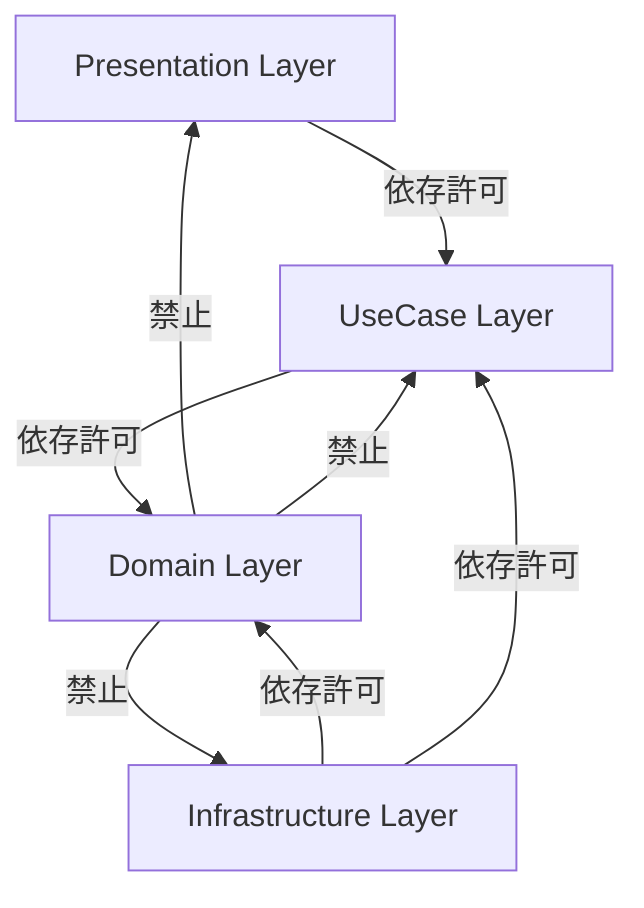

# SES勤怠管理・勤務報告書システム 非機能要件定義書

## 1. 性能・スケーラビリティ要件

### 1.1 応答性能目標 (Response Time)
すべてのレスポンス時間は、一般的なイントラネットおよびブロードバンド環境において以下の目標値を満たすこと。

| 処理区分 | 対象URL / 処理内容 | 目標応答時間 (95パーセンタイル) | 最大許容時間 | 測定条件・前提 |
| :--- | :--- | :--- | :--- | :--- |
| **画面初期表示** | `/shainList.do`, `/sesAttendance.do` | **1.0秒以内** | 2.0秒以内 | 社員数100名、当月勤怠31件の結合取得時 |
| **非同期保存API** | `/api/sesAttendance.do` | **0.3秒以内** | 0.8秒以内 | 1日分の勤怠登録＋月次再集計計算完了まで |
| **月間一括適用** | テンプレート適用ユースケース | **0.8秒以内** | 1.5秒以内 | 31日分のカレンダー判定＋一括UPSERT |
| **有給一括付与** | 有給付与バッチ実行 | **1.5秒以内** | 3.0秒以内 | 全社員（100名規模）のトランザクション更新 |

### 1.2 同時実行性・スループット
- **定常アクセス**: 同時アクティブユーザー 50〜100名。
- **月末締め日ピークアクセス**: 毎月末営業日の17:00〜19:00において、同時アクセス 200〜300名に耐えうること。
- **リクエスト処理能力**: 1秒あたり50リクエスト（50 TPS）以上をエラーなく処理可能であること。

### 1.3 データベースコネクションプール設計
Tomcatの `META-INF/context.xml` にて以下のJNDI DataSourceプール設定を標準とする。

```xml
<Resource name="jdbc/kintai"
    auth="Container"
    type="javax.sql.DataSource"
    driverClassName="com.mysql.cj.jdbc.Driver"
    url="jdbc:mysql://localhost:3306/kintai?serverTimezone=Asia/Tokyo&amp;characterEncoding=UTF-8"
    username="kintai"
    password="kintai"
    maxTotal="100"
    maxIdle="30"
    minIdle="10"
    maxWaitMillis="10000"
    validationQuery="SELECT 1"
    testOnBorrow="true"
    removeAbandonedOnBorrow="true"
    removeAbandonedTimeout="60"
/>
```
- **枯渇対策**: `maxTotal=100` によりピーク時でも接続待ちが10秒（`maxWaitMillis=10000`）以内に解消されること。
- **リーク防止**:万が一コネクション解放漏れ（`close()` 漏れ）が発生した場合でも、`removeAbandonedOnBorrow=true` により60秒経過した接続を自動回収。

---

## 2. 可用性・信頼性要件

### 2.1 稼働率および許容停止時間
- **目標稼働率**: 年間 99.5% 以上（年間累計停止時間 43.8時間以内）。
- **計画停止**: 月1回のシステムメンテナンス（毎月第3日曜 深夜2:00〜5:00の最大3時間）。
- **目標復旧指標**:
  - **RTO (Recovery Time Objective)**: 障害発生から4時間以内の業務再開。
  - **RPO (Recovery Point Objective)**: 障害直前の最大1時間前までのデータ復元（バイナリログ運用時）。

### 2.2 バックアップ運用戦略
| バックアップ種別 | 対象データ | 頻度・タイミング | 保持期間 | 保存先 |
| :--- | :--- | :--- | :--- | :--- |
| **フルバックアップ** | `mysqldump` 全テーブル＋DDL | 毎日深夜 03:00 | 30世代 (1ヶ月) | 外部ストレージ / S3 |
| **設定・資材バックアップ** | WARファイル、Tomcat設定 | デプロイ時 | 直近5世代 | アプリケーションリポジトリ |

---

## 3. セキュリティ要件

### 3.1 認証およびセッション管理
- **認証基盤**: 社員ID・パスワードによる認証（`login_table`）。
- **セッションセキュリティ**:
  - `JSESSIONID` クッキーには `HttpOnly` フラグを付与し、JavaScriptからの不正読み取り（XSSによるセッショントークン奪取）を防止。
  - 本番運用時は `Secure` フラグ（HTTPS通信限定）を必須とする。
  - セッション有効期限: 無操作30分で自動破棄。
  - ログアウト時は `session.invalidate()` を即時実行。

### 3.2 認可およびアクセス制御 (RBAC)
- プレゼンテーション層（Action）の入口でロール判定を行い、権限のないAction実行を遮断。
- 他社員の勤怠データへのアクセス時、セッションの社員IDと一致するか、あるいはマネージャー/管理者権限を保持しているかを厳格に検証（IDOR: 不適切な直接オブジェクト参照の防止）。

### 3.3 脆弱性対策
1. **SQLインジェクション完全防止**:
   - DAOおよびリポジトリ実装において、文字列連結によるSQL生成を**一切禁止**とする。
   - すべてのプレースホルダーに `PreparedStatement` の型バインド（`setInt`, `setString` 等）を使用すること。
2. **クロスサイトスクリプティング (XSS) 防止**:
   - JSPでの表示にはスクリプトレット（`<%= %>`）を全廃し、JSTLの `<c:out value="..."/>` または EL式 `${...}` を使用してHTML自動エスケープを徹底。
3. **安全なエラーハンドリング**:
   - 例外発生時にスタックトレースや内部SQLエラーを画面にそのまま表示しない。
   - `WEB-INF/view/error.jsp` を用意し、ユーザーには安全なエラーコードと汎用メッセージのみを通知。例外詳細はサーバーログに記録。

---

## 4. アーキテクチャ・コード品質要件

### 4.1 レイヤー独立性・依存性ルール
システムは以下の依存性ルールを厳格に順守すること。違反はコードレビューおよび静的解析で弾く。



- **ドメインのPOJO性**: `domain` パッケージ内のクラスは、`javax.servlet.*`, `java.sql.*` などのインフラ技術に依存するインポートを一切持ってはいけない。
- **依存性逆転の原則 (DIP)**: ユースケースはインターフェース（`AttendanceRepository` 等）にのみ依存し、具象クラス（`JdbcAttendanceRepository`）には依存しない。

### 4.2 テスト自動化・品質基準
- **単体テスト基盤**: JUnit 5 を使用。
- **テスト自動化要件**:
  - ドメインモデル（`domain` 配下）の計算ロジック（精算幅、36協定判定、中抜け計算、週報アラート）は、**DB不要・モック不要の高速単体テスト**を全ケース作成すること。
  - `mvn test` の実行時間は**3秒以内**を維持すること（テストが重くならない工夫）。
  - ドメイン層のブランチカバレッジ 80% 以上を維持すること。

---

## 5. 動作環境・制約要件

### 5.1 サーバー環境
| コンポーネント | 指定技術・バージョン | 備考 |
| :--- | :--- | :--- |
| **OS** | Linux (Ubuntu 22.04 LTS / RHEL 9) または macOS / Windows | 開発環境はマルチOS対応 |
| **Java実行環境** | OpenJDK 11 (LTS) | 64-bit JVM |
| **サーブレットコンテナ** | Apache Tomcat 9.0.x | Java EE 8 / Servlet 4.0 |
| **データベース** | MySQL 8.0.x | InnoDBエンジン, `utf8mb4` |
| **ビルドツール** | Apache Maven 3.8.x 以上 | |

### 5.2 データベース環境仕様
- **デフォルト文字セット**: `utf8mb4`
- **デフォルト照合順序**: `utf8mb4_general_ci`
- **タイムゾーン設定**: `Asia/Tokyo` (`+09:00`)
- **SQLモード**: `STRICT_TRANS_TABLES,NO_ENGINE_SUBSTITUTION`