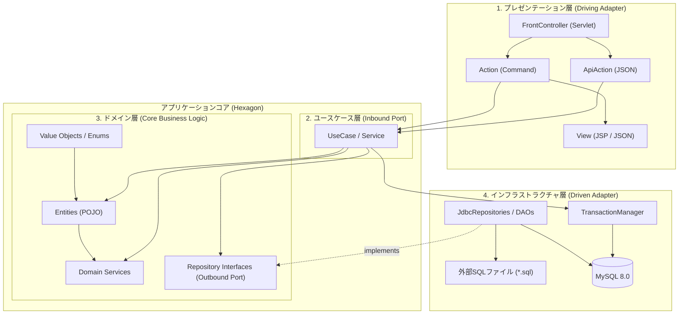
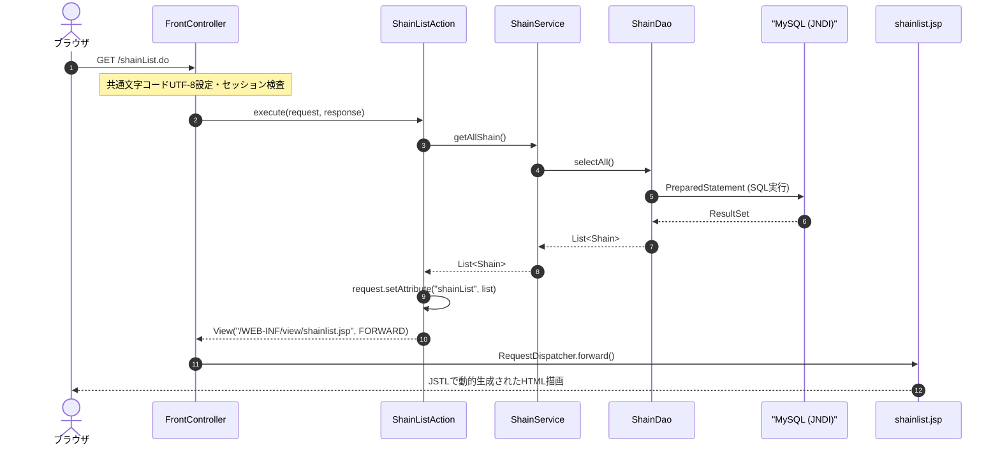
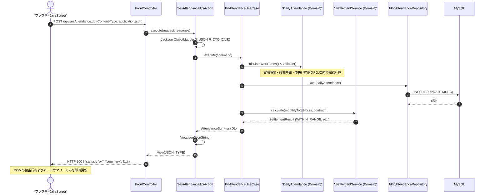

# SES勤怠管理・勤務報告書システム アーキテクチャ設計書

## 1. アーキテクチャ全体方針

本システムは、特定の巨大フレームワーク（Spring Boot等）に依存せず、Java標準仕様（Java 11 / Servlet 4.0）のみを用いて、保守性・テスト容易性・拡張性を極限まで高めた設計を採用しています。

採用している核となる設計パターン：
1. **ヘキサゴナル／クリーンアーキテクチャ（Ports and Adapters）**: ビジネスロジック（Domain）を中心（コア）に据え、Webやデータベース（Infrastructure）を外部アダプターとして疎結合化。
2. **FrontController + Commandパターン**: Webリクエストの一元受付と個別アクションへの委譲。
3. **自己防衛ドメイン（Self-Defending Domain）**: ドメインモデル自身がバリデーションと計算の正しさを保証し、不正な状態を拒絶。
4. **プログラマティック・トランザクション（TransactionManager）**: ラムダ式を用いた関数型アプローチによる、安全・確実なトランザクション境界制御。

---

## 2. 4層レイヤー構造と責務



### レイヤー詳細定義表

| レイヤー名 | パッケージ | 主な役割・責務 | 依存してよいもの | 依存してはいけないもの |
| :--- | :--- | :--- | :--- | :--- |
| **1. プレゼンテーション層** | `controller`<br>`controller.action`<br>`controller.api` | HTTPリクエスト解析、入力DTO構築、UseCase呼出し、View/JSONへのレスポンス生成。 | `usecase.*`<br>`domain.*`<br>`javax.servlet.*` | `infrastructure.*`<br>`java.sql.*` (直接SQL実行) |
| **2. ユースケース層** | `usecase.attendance`<br>`usecase.contract`<br>`usecase.shain`<br>`usecase.weeklyreport` | 業務ユースケースの手順制御、トランザクション境界の確定、Portの呼出し。 | `domain.*`<br>`infrastructure.db.TransactionManager` | `javax.servlet.*` (HTTP依存)<br>`infrastructure.persistence.*` (具象DAO) |
| **3. ドメイン層** | `domain.attendance`<br>`domain.contract`<br>`domain.compliance`<br>`domain.shain`<br>`domain.auth`<br>`domain.weeklyreport` | 純粋なビジネスルール、精算計算式、コンプライアンス判定、Repositoryインターフェース定義。 | 純粋Java (Java SE) のみ (`java.time.*`, `java.util.*`) | フレームワーク、Servlet、JDBC、インフラ層全般 |
| **4. インフラストラクチャ層** | `infrastructure.persistence`<br>`infrastructure.db` | ドメインのRepositoryインターフェース実装、JDBC接続、SQL発行、トランザクション実行。 | `domain.*`<br>`java.sql.*`<br>`javax.sql.DataSource` | `controller.*` |

---

## 3. パッケージ配置と主要クラス構成

```text
src/main/java/
├── controller/                   # [プレゼンテーション層]
│   ├── FrontController.java      # URLディスパッチャ（*.do を一括受付け）
│   ├── Action.java               # コマンドI/F (execute(req, resp): View)
│   ├── View.java                 # 遷移先パス + ディスパッチ種別(FORWARD/REDIRECT/JSON)
│   ├── action/                   # 画面遷移Action群
│   │   ├── LoginAction.java / LoginExecuteAction.java / LogoutAction.java
│   │   ├── ShainListAction.java / ShainInsertFormAction.java / ShainInsertExecuteAction.java
│   │   ├── ShainUpdateFormAction.java / ShainUpdateExecuteAction.java
│   │   ├── ShainDeleteFormAction.java / ShainDeleteExecuteAction.java
│   │   ├── SesAttendanceAction.java
│   │   └── PaidLeaveAdminAction.java
│   └── api/                      # 非同期JSON Action群
│       └── SesAttendanceApiAction.java
├── usecase/                      # [ユースケース層]
│   ├── attendance/               # ApplyMonthlyTemplateUseCase, FillAttendanceUseCase
│   ├── contract/                 # CalculateSettlementUseCase
│   ├── shain/                    # ShainService, LeaveService, ClassmasterService
│   └── weeklyreport/             # SubmitWeeklyReportUseCase, ReviewWeeklyReportUseCase
├── domain/                       # [ドメイン層 (コア)]
│   ├── attendance/               # DailyAttendance, WorkTimeSegment, LeaveType, AttendanceRepository
│   ├── auth/                     # UserSession, UserRole, AuthRepository
│   ├── compliance/               # Article36ComplianceService, OvertimeLevel, PaidLeaveComplianceService
│   ├── contract/                 # ProjectContract, Assignment, SettlementService, SettlementResult, ContractRepository
│   ├── shain/                    # Shain, LeaveGrantRule, Classmaster
│   └── weeklyreport/             # WeeklyReport, WeeklyReportComment, ReportStatus, WeeklyReportRepository
├── infrastructure/               # [インフラストラクチャ層]
│   ├── db/                       # TransactionManager, ConnectionBase, TransactionalOperation
│   └── persistence/              # JdbcAttendanceRepository, ShainDao, LeaveDao, ClassmasterDao等
└── common/                       # [共通ユーティリティ] MyUtil
```

---

## 4. リクエスト処理シーケンス

### 4.1 画面遷移リクエスト (FrontController + Commandパターン)



### 4.2 非同期更新リクエスト (Fetch API + JSONレスポンス)



---

## 5. 詳細設計パターン

### 5.1 トランザクション管理設計 (`TransactionManager`)
Service層で手動の `try-catch` や `con.commit()` を記述すると解放漏れが多発します。本アーキテクチャでは、関数型インターフェース `TransactionalOperation` を受け取る `TransactionManager` を導入しています。

```java
public class TransactionManager {
    public static <T> T execute(TransactionalOperation<T> operation) throws Exception {
        Connection con = null;
        try {
            con = ConnectionBase.getConnection();
            con.setAutoCommit(false); // トランザクション開始
            
            T result = operation.execute(con);
            
            con.commit(); // 正常終了時コミット
            return result;
        } catch (Exception e) {
            if (con != null) {
                try { con.rollback(); } catch (SQLException ex) { /* log */ }
            }
            throw e;
        } finally {
            if (con != null) {
                try { con.close(); } catch (SQLException ex) { /* log */ }
            }
        }
    }
}
```

### 5.2 依存性逆転の原則 (DIP) とテスト容易性
ドメイン層のユースケースは、外部DBへの依存をインターフェース（ポート）で切り離しています。

```java
// ドメイン層 (Outbound Port)
package domain.attendance;
public interface AttendanceRepository {
    void save(DailyAttendance attendance);
    List<DailyAttendance> findByMonth(String employeeId, YearMonth yearMonth);
}
```

この設計により、単体テスト（JUnit 5）ではメモリ内のダミー実装やスタブを用いて、**データベースやTomcatを起動することなくミリ秒単位でビジネスロジックをテスト可能**です。
