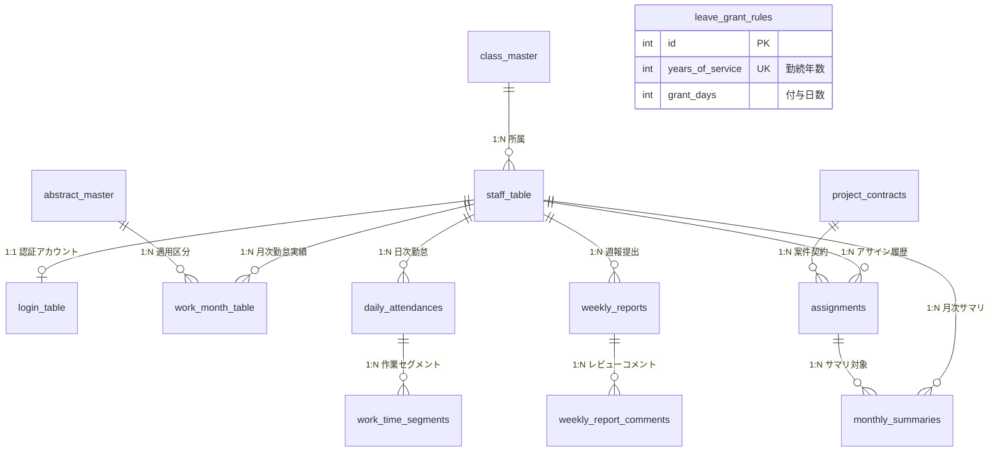

# SES勤怠管理・勤務報告書システム データモデル設計書

## 1. データベース概要

- **DBMS**: MySQL 8.0 Community Server
- **ストレージエンジン**: InnoDB（行レベルロック、外部キー制約、ACID準拠）
- **文字コード**: `utf8mb4`（照合順序: `utf8mb4_general_ci`）
- **タイムゾーン**: `Asia/Tokyo`
- **データベース名**: `kintai`
- **DDLファイル配置**: `20.db/createtb/all_createtables.sql`, `ses_tables.sql`, `all_createviews.sql`

---

## 2. 全体ER図 (Entity-Relationship Diagram)

---

## 3. 基本テーブル完全定義書

### 3.1 class_master（役職マスタ）
役職コードおよび役職名称を管理。

| カラム物理名 | カラム論理名 | データ型 | NULL | PK | デフォルト | 外部キー / 備考 |
| :--- | :--- | :--- | :---: | :---: | :--- | :--- |
| `ID` | 役職区分コード | VARCHAR(40) | NO | ◯ | なし | 例: '01'(役員), '03'(課長), '05'(一般) |
| `NAME` | 役職名称 | VARCHAR(40) | YES | - | NULL | 表示名（例: 代表取締役, 課長, 一般社員） |

### 3.2 staff_table（社員テーブル）
全社員の基本情報および有給休暇残日数を保持。

| カラム物理名 | カラム論理名 | データ型 | NULL | PK | デフォルト | 外部キー / 備考 |
| :--- | :--- | :--- | :---: | :---: | :--- | :--- |
| `ID` | 社員ID | INT | NO | ◯ | なし | 社員固有識別子（4桁以上） |
| `NAME` | 社員氏名 | VARCHAR(40) | NO | - | なし | 漢字氏名 |
| `NAMEKANA` | 社員カナ | VARCHAR(40) | YES | - | NULL | 全角カタカナ |
| `ENTRY_YEAR` | 入社年度 | INT | NO | - | なし | 西暦年（有給付与年数算出キー） |
| `GENDER` | 性別 | VARCHAR(10) | YES | - | NULL | '男', '女' |
| `CLASS_ID` | 役職区分 | VARCHAR(40) | NO | - | なし | FK → `class_master(ID)` ON UPDATE CASCADE |
| `PAID_LEAVE_DAYS`| 有給残日数 | INT | YES | - | 20 | 現在の保有有給休暇日数（最大40日） |

### 3.3 login_table（社員ログインテーブル）
社員の認証用アカウント情報。

| カラム物理名 | カラム論理名 | データ型 | NULL | PK | デフォルト | 外部キー / 備考 |
| :--- | :--- | :--- | :---: | :---: | :--- | :--- |
| `USERNAME` | ログインID | INT | NO | ◯ | なし | FK → `staff_table(ID)` ON UPDATE CASCADE |
| `PASSWORD` | パスワード | VARCHAR(500) | NO | - | なし | パスワード文字列 |
| `ENABLED` | 有効フラグ | TINYINT(1) | NO | - | 1 | 1: 有効, 0: アカウント凍結 |
| `EXPIRATION_DATE`| 有効期限 | DATE | YES | - | NULL | パスワード有効期限 |

### 3.4 abstract_master（適用マスタ）
勤怠区分（通常出勤、有給休暇、特別休暇、欠勤、休日等）の属性定義。

| カラム物理名 | カラム論理名 | データ型 | NULL | PK | デフォルト | 備考 |
| :--- | :--- | :--- | :---: | :---: | :--- | :--- |
| `ID` | 適用区分ID | INT | NO | ◯ | なし | 1: 通常出勤, 2: 有給, 3: 特休, 4: 欠勤, 5: 法休, 6: 所休 |
| `NAME` | 適用名称 | VARCHAR(40) | YES | - | NULL | 画面表示名称 |
| `IS_WORK` | 労働日フラグ | TINYINT(1) | YES | - | 0 | 1: 労働日, 0: 休日 |
| `IS_PAID` | 有給対象フラグ | TINYINT(1) | YES | - | 0 | 1: 有給対象（給与控除なし） |
| `IS_LEGAL_HOLIDAY` | 法定休日フラグ | TINYINT(1) | YES | - | 0 | 1: 法定休日（週1日の休日） |
| `IS_PRESCRIBED_HOLIDAY`| 所定休日フラグ | TINYINT(1) | YES | - | 0 | 1: 所定休日（会社の定めによる休日） |

### 3.5 work_month_table（勤怠月テーブル）
社員の月次勤怠実績明細（基本システム用）。

| カラム物理名 | カラム論理名 | データ型 | NULL | PK | デフォルト | 備考 |
| :--- | :--- | :--- | :---: | :---: | :--- | :--- |
| `STAFF_ID` | 社員ID | INT | NO | ◯ | なし | FK → `staff_table(ID)` |
| `WORK_DATE` | 勤務日 | DATE | NO | ◯ | なし | 対象日付（インデックス作成） |
| `WORK_WEEK` | 曜日 | VARCHAR(100) | YES | - | NULL | '月', '火', '水', '木', '金', '土', '日' |
| `CORRECTION_ID` | 補正区分 | INT | YES | - | NULL | テンプレート適用区分 |
| `JOB_FROM_TIME` | 出勤時刻 | DATETIME | YES | - | NULL | 打刻・入力始業日時 |
| `JOB_TO_TIME` | 退勤時刻 | DATETIME | YES | - | NULL | 打刻・入力終業日時 |
| `CORRECTION_US_TIME` | 稼働補正(通常) | INT | YES | - | NULL | 分単位補正値 |
| `CORRECTION_MID_TIME`| 稼働補正(深夜) | INT | YES | - | NULL | 分単位深夜補正値 |
| `INDIRECT_TIME` | 間接時間 | INT | YES | - | NULL | 分単位間接時間 |
| `TOTAL_WORK_TIME` | 総稼働時間 | INT | YES | - | NULL | 分単位実労働時間 |
| `TOTAL_DIRECT_WORK_TIME`| 直接稼働時間 | INT | YES | - | NULL | 分単位直接作業時間 |
| `OVERTIME` | 法定外残業 | INT | YES | - | NULL | 分単位時間外労働時間 |
| `ABSTRACT_ID` | 適用区分 | INT | YES | - | NULL | FK → `abstract_master(ID)` |
| `REMARKS` | 備考 | VARCHAR(200) | YES | - | NULL | 業務所感・中抜け理由 |

### 3.6 leave_grant_rules（有給付与ルールテーブル）
勤続年数に応じた法定有給休暇付与日数定義。

| カラム物理名 | カラム論理名 | データ型 | NULL | PK | デフォルト | 備考 |
| :--- | :--- | :--- | :---: | :---: | :--- | :--- |
| `id` | ルールID | INT | NO | ◯ | AUTO_INC | 自動採番 |
| `years_of_service`| 勤続年数 | INT | NO | - | なし | UNIQUE制約。0(入社時), 1, 2, 3, 4, 5, 6 |
| `grant_days` | 付与日数 | INT | NO | - | なし | 10, 11, 12, 14, 16, 18, 20 |

---

## 4. SES拡張テーブル完全定義書

### 4.1 project_contracts（案件契約テーブル）
クライアント企業との準委任契約における精算幅・就業基準。

| カラム物理名 | カラム論理名 | データ型 | NULL | PK | デフォルト | 備考 |
| :--- | :--- | :--- | :---: | :---: | :--- | :--- |
| `id` | 契約ID | VARCHAR(64) | NO | ◯ | なし | UUIDまたは識別キー |
| `client_name` | クライアント企業名 | VARCHAR(128) | NO | - | なし | 契約先企業名称 |
| `billing_lower_limit_hours` | 精算下限時間 | DECIMAL(5,2)| NO | - | なし | 例: 140.00 |
| `billing_upper_limit_hours` | 精算上限時間 | DECIMAL(5,2)| NO | - | なし | 例: 180.00 |
| `default_start_time` | 標準始業時刻 | TIME | NO | - | '09:00:00' | 現場の標準就業開始 |
| `default_end_time` | 標準終業時刻 | TIME | NO | - | '18:00:00' | 現場の標準就業終了 |
| `default_break_minutes` | 標準休憩時間 | INT | NO | - | 60 | 分単位休憩時間 |
| `created_at` | 登録日時 | TIMESTAMP | YES | - | CURRENT_TIMESTAMP | レコード作成日時 |

### 4.2 assignments（案件アサインテーブル）
エンジニアと案件契約の紐付け履歴。

| カラム物理名 | カラム論理名 | データ型 | NULL | PK | デフォルト | 備考 |
| :--- | :--- | :--- | :---: | :---: | :--- | :--- |
| `id` | アサインID | VARCHAR(64) | NO | ◯ | なし | 識別キー |
| `employee_id` | 社員ID | VARCHAR(64) | NO | - | なし | 対象社員 |
| `project_contract_id` | 案件契約ID | VARCHAR(64) | NO | - | なし | FK → `project_contracts(id)` |
| `start_date` | アサイン開始日 | DATE | NO | - | なし | 参画日 |
| `end_date` | アサイン終了日 | DATE | YES | - | NULL | 契約終了予定日 |
| `allocation_ratio` | 稼働割合 | DECIMAL(3,2)| NO | - | 1.00 | 1.00 = 100% 稼働 |
| `created_at` | 登録日時 | TIMESTAMP | YES | - | CURRENT_TIMESTAMP | |

### 4.3 daily_attendances（日次勤怠テーブル）
SES特有の入力をサポートする日次勤怠。

| カラム物理名 | カラム論理名 | データ型 | NULL | PK | デフォルト | 備考 |
| :--- | :--- | :--- | :---: | :---: | :--- | :--- |
| `id` | 日次勤怠ID | VARCHAR(64) | NO | ◯ | なし | 識別キー |
| `employee_id` | 社員ID | VARCHAR(64) | NO | - | なし | UNIQUE複合キー (employee_id, work_date) |
| `work_date` | 勤務日 | DATE | NO | - | なし | UNIQUE複合キー |
| `start_time` | 始業時刻 | TIME | YES | - | '09:00:00' | |
| `end_time` | 終業時刻 | TIME | YES | - | '18:00:00' | |
| `break_minutes` | 休憩時間 | INT | NO | - | 60 | 分単位 |
| `abstract_id` | 適用区分ID | INT | YES | - | 1 | FK → `abstract_master(ID)` |
| `leave_type` | 休暇区分種別 | VARCHAR(32) | NO | - | 'NORMAL' | 'NORMAL', 'PAID_LEAVE', 'SPECIAL' 等 |
| `remarks` | 備考・作業内容 | TEXT | YES | - | NULL | |
| `is_filled` | 入力済フラグ | BOOLEAN | NO | - | FALSE | 実績入力有無 |
| `is_locked` | ロックフラグ | BOOLEAN | NO | - | FALSE | 月末締め確定後の編集不可制御 |
| `created_at` | 登録日時 | TIMESTAMP | YES | - | CURRENT_TIMESTAMP | |
| `updated_at` | 更新日時 | TIMESTAMP | YES | - | CURRENT_TIMESTAMP | ON UPDATE CURRENT_TIMESTAMP |

### 4.4 work_time_segments（作業明細セグメントテーブル）
1日における直接作業・間接作業の明細時間。

| カラム物理名 | カラム論理名 | データ型 | NULL | PK | デフォルト | 備考 |
| :--- | :--- | :--- | :---: | :---: | :--- | :--- |
| `id` | セグメントID | VARCHAR(64) | NO | ◯ | なし | 識別キー |
| `daily_attendance_id` | 日次勤怠ID | VARCHAR(64) | NO | - | なし | FK → `daily_attendances(id)` ON DELETE CASCADE |
| `category` | 作業分類 | VARCHAR(16) | NO | - | なし | 'DIRECT' (直接) / 'INDIRECT' (間接) |
| `duration_minutes` | 作業時間 | INT | NO | - | なし | 分単位 |
| `task_description` | タスク内容 | TEXT | YES | - | NULL | タスク名・作業工程詳細 |
| `created_at` | 登録日時 | TIMESTAMP | YES | - | CURRENT_TIMESTAMP | |

### 4.5 weekly_reports（週報テーブル）
週次の作業進捗および負荷・健康スコア。

| カラム物理名 | カラム論理名 | データ型 | NULL | PK | デフォルト | 備考 |
| :--- | :--- | :--- | :---: | :---: | :--- | :--- |
| `id` | 週報ID | VARCHAR(64) | NO | ◯ | なし | 識別キー |
| `employee_id` | 社員ID | VARCHAR(64) | NO | - | なし | UNIQUE複合キー (employee_id, year_week) |
| `year_week` | 年週番号 | VARCHAR(16) | NO | - | なし | 例: '2026-W41' |
| `task_title` | 作業件名・工程 | TEXT | YES | - | NULL | |
| `task_progress` | 作業進捗・詳細 | TEXT | YES | - | NULL | |
| `personal_reflection` | 本人所感 | TEXT | YES | - | NULL | |
| `progress_summary` | 要約 | TEXT | YES | - | NULL | |
| `next_week_plan` | 来週の予定 | TEXT | YES | - | NULL | |
| `workload_score` | 業務負荷スコア | INT | NO | - | 3 | 1(余裕) 〜 5(限界) |
| `health_score` | 心身健康スコア | INT | NO | - | 3 | 1(不調) 〜 5(快調) |
| `escalation_needed` | エスカレーション | BOOLEAN | NO | - | FALSE | 営業・上司への相談要請フラグ |
| `status` | 承認状態 | VARCHAR(32) | NO | - | 'DRAFT' | 'DRAFT', 'SUBMITTED', 'APPROVED', 'REJECTED' |
| `submitted_at` | 提出日時 | TIMESTAMP | YES | - | NULL | |
| `created_at` | 作成日時 | TIMESTAMP | YES | - | CURRENT_TIMESTAMP | |
| `updated_at` | 更新日時 | TIMESTAMP | YES | - | CURRENT_TIMESTAMP | |

### 4.6 weekly_report_comments（週報レビューコメント履歴）
上司・営業による週報へのフィードバックコメント。

| カラム物理名 | カラム論理名 | データ型 | NULL | PK | デフォルト | 備考 |
| :--- | :--- | :--- | :---: | :---: | :--- | :--- |
| `id` | コメントID | VARCHAR(64) | NO | ◯ | なし | 識別キー |
| `weekly_report_id` | 対象週報ID | VARCHAR(64) | NO | - | なし | FK → `weekly_reports(id)` ON DELETE CASCADE |
| `author_id` | 記入者ID | VARCHAR(64) | NO | - | なし | 上司・管理者の社員ID |
| `author_role` | 記入者ロール | VARCHAR(32) | NO | - | なし | 'MANAGER', 'ADMIN' |
| `comment` | コメント本文 | TEXT | NO | - | なし | |
| `is_private_to_mgmt` | 社内管理限定 | BOOLEAN | NO | - | FALSE | TRUEの場合本人には非公開 |
| `created_at` | 登録日時 | TIMESTAMP | YES | - | CURRENT_TIMESTAMP | |

### 4.7 monthly_summaries（月次サマリテーブル）
月間の総稼働・精算ステータス確定値。

| カラム物理名 | カラム論理名 | データ型 | NULL | PK | デフォルト | 備考 |
| :--- | :--- | :--- | :---: | :---: | :--- | :--- |
| `id` | サマリID | VARCHAR(64) | NO | ◯ | なし | 識別キー |
| `employee_id` | 社員ID | VARCHAR(64) | NO | - | なし | UNIQUE複合キー (employee_id, year_month) |
| `year_month` | 対象年月 | VARCHAR(16) | NO | - | なし | 例: '2026-10' |
| `assignment_id` | アサインID | VARCHAR(64) | NO | - | なし | FK → `assignments(id)` |
| `total_work_minutes` | 総実働時間 | INT | NO | - | 0 | 分単位 |
| `direct_minutes` | 直接作業時間 | INT | NO | - | 0 | 分単位 |
| `indirect_minutes` | 間接作業時間 | INT | NO | - | 0 | 分単位 |
| `legal_overtime_minutes`| 法定時間外残業 | INT | NO | - | 0 | 分単位 |
| `settlement_status` | 精算ステータス | VARCHAR(32) | NO | - | 'WITHIN_RANGE' | 'WITHIN_RANGE', 'DEDUCTION', 'OVERTIME' |
| `status` | 確定状態 | VARCHAR(32) | NO | - | 'DRAFT' | 'DRAFT', 'CONFIRMED', 'BILLED' |
| `created_at` | 作成日時 | TIMESTAMP | YES | - | CURRENT_TIMESTAMP | |
| `updated_at` | 更新日時 | TIMESTAMP | YES | - | CURRENT_TIMESTAMP | |
