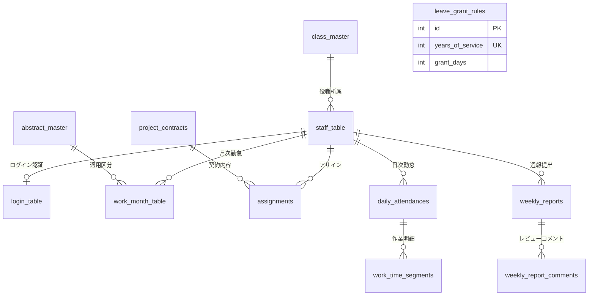

# SES勤怠管理・勤務報告書システム要件定義書
## 05. データ定義書

### 5.1 データベース設計概要
- **DBMS**: MySQL 8.0
- **文字セット**: `utf8mb4`
- **照合順序**: `utf8mb4_general_ci`
- **ストレージエンジン**: InnoDB
- **データベース名**: `kintai`

---

## 5.2 ER図 (Entity-Relationship Diagram)

---

## 5.3 基本テーブル仕様 (`all_createtables.sql`)

### 5.3.1 class_master（役職マスタ）
| カラム名 | データ型 | 制約 | 説明 |
| :--- | :--- | :--- | :--- |
| `ID` | VARCHAR(40) | PK, NOT NULL | 役職区分コード（例: 01: 社長, 05: 一般） |
| `NAME` | VARCHAR(40) | | 役職名称 |

### 5.3.2 staff_table（社員テーブル）
| カラム名 | データ型 | 制約 | 説明 |
| :--- | :--- | :--- | :--- |
| `ID` | INT | PK, NOT NULL | 社員ID（ログインUSERNAMEと連携） |
| `NAME` | VARCHAR(40) | NOT NULL | 社員氏名 |
| `NAMEKANA` | VARCHAR(40) | | 社員カナ氏名 |
| `ENTRY_YEAR` | INT | NOT NULL | 入社年度（有給付与年数算出に使用） |
| `GENDER` | VARCHAR(10) | | 性別 |
| `CLASS_ID` | VARCHAR(40) | FK (`class_master.ID`), NOT NULL | 役職区分 |
| `PAID_LEAVE_DAYS`| INT | DEFAULT 20 | 有給休暇残日数 |

### 5.3.3 login_table（社員ログインテーブル）
| カラム名 | データ型 | 制約 | 説明 |
| :--- | :--- | :--- | :--- |
| `USERNAME` | INT | PK, FK (`staff_table.ID`), NOT NULL | ログインID (社員ID) |
| `PASSWORD` | VARCHAR(500) | NOT NULL | ログインパスワード |
| `ENABLED` | TINYINT(1) | NOT NULL | 有効フラグ (1: 有効, 0: 無効) |
| `EXPIRATION_DATE`| DATE | | パスワード有効期限 |

### 5.3.4 abstract_master（適用マスタ）
| カラム名 | データ型 | 制約 | 説明 |
| :--- | :--- | :--- | :--- |
| `ID` | INT | PK, NOT NULL | 適用区分コード |
| `NAME` | VARCHAR(40) | | 適用名称（通常勤務、有給休暇、特別休暇等） |
| `IS_WORK` | TINYINT(1) | DEFAULT 0 | 労働日フラグ (1: 労働日, 0: 休日) |
| `IS_PAID` | TINYINT(1) | DEFAULT 0 | 有給対象フラグ (1: 有給) |
| `IS_LEGAL_HOLIDAY` | TINYINT(1) | DEFAULT 0 | 法定休日フラグ (1: 法定休日) |
| `IS_PRESCRIBED_HOLIDAY`| TINYINT(1) | DEFAULT 0 | 所定休日フラグ (1: 所定休日) |

### 5.3.5 work_month_table（勤怠月テーブル）
| カラム名 | データ型 | 制約 | 説明 |
| :--- | :--- | :--- | :--- |
| `STAFF_ID` | INT | PK, FK (`staff_table.ID`), NOT NULL | 社員ID |
| `WORK_DATE` | DATE | PK, NOT NULL | 勤務日 |
| `WORK_WEEK` | VARCHAR(100) | | 曜日文字列 |
| `CORRECTION_ID` | INT | | 稼働補正テンプレートコード |
| `JOB_FROM_TIME` | DATETIME | | 出勤時刻 |
| `JOB_TO_TIME` | DATETIME | | 退勤時刻 |
| `CORRECTION_US_TIME` | INT | | 稼働時間補正（通常・分） |
| `CORRECTION_MID_TIME`| INT | | 稼働時間補正（深夜・分） |
| `INDIRECT_TIME` | INT | | 客先間接時間（分） |
| `TOTAL_WORK_TIME` | INT | | 総稼働時間（分） |
| `TOTAL_DIRECT_WORK_TIME`| INT | | 総稼働時間（直接・分） |
| `OVERTIME` | INT | | 法定外残業時間（分） |
| `ABSTRACT_ID` | INT | FK (`abstract_master.ID`) | 適用区分 |
| `REMARKS` | VARCHAR(200) | | 備考・所感 |

### 5.3.6 leave_grant_rules（有給付与ルールテーブル）
| カラム名 | データ型 | 制約 | 説明 |
| :--- | :--- | :--- | :--- |
| `id` | INT | PK, AUTO_INCREMENT | ルールID |
| `years_of_service`| INT | UNIQUE, NOT NULL | 勤続年数 (0: 入社時, 1, 2, 3...) |
| `grant_days` | INT | NOT NULL | 付与日数 (10, 11, 12, 14, 16, 18, 20) |

---

## 5.4 SES拡張テーブル仕様 (`ses_tables.sql`)

### 5.4.1 project_contracts（案件契約テーブル）
| カラム名 | データ型 | 制約 | 説明 |
| :--- | :--- | :--- | :--- |
| `id` | VARCHAR(64) | PK, NOT NULL | 契約ID |
| `client_name` | VARCHAR(128) | NOT NULL | クライアント企業名 |
| `billing_lower_limit_hours` | DECIMAL(5,2) | NOT NULL | 精算下限時間（例: 140.00） |
| `billing_upper_limit_hours` | DECIMAL(5,2) | NOT NULL | 精算上限時間（例: 180.00） |
| `default_start_time` | TIME | DEFAULT '09:00:00' | 標準始業時刻 |
| `default_end_time` | TIME | DEFAULT '18:00:00' | 標準終業時刻 |
| `default_break_minutes` | INT | DEFAULT 60 | 標準休憩時間（分） |
| `created_at` | TIMESTAMP | DEFAULT CURRENT_TIMESTAMP | 登録日時 |

### 5.4.2 assignments（案件アサインテーブル）
| カラム名 | データ型 | 制約 | 説明 |
| :--- | :--- | :--- | :--- |
| `id` | VARCHAR(64) | PK, NOT NULL | アサインID |
| `employee_id` | VARCHAR(64) | NOT NULL | 対象社員ID |
| `project_contract_id` | VARCHAR(64) | FK (`project_contracts.id`) | 案件契約ID |
| `start_date` | DATE | NOT NULL | アサイン開始日 |
| `end_date` | DATE | | アサイン終了日 |
| `allocation_ratio` | DECIMAL(3,2) | DEFAULT 1.00 | 稼働割合（例: 1.00 = 100%） |

### 5.4.3 daily_attendances（日次勤怠テーブル）
| カラム名 | データ型 | 制約 | 説明 |
| :--- | :--- | :--- | :--- |
| `id` | VARCHAR(64) | PK, NOT NULL | 日次勤怠ID |
| `employee_id` | VARCHAR(64) | NOT NULL | 社員ID |
| `work_date` | DATE | NOT NULL | 対象日 |
| `start_time` | TIME | | 出勤時刻 |
| `end_time` | TIME | | 退勤時刻 |
| `break_minutes` | INT | DEFAULT 60 | 休憩時間（分） |
| `abstract_id` | INT | DEFAULT 1 | 適用区分ID |
| `leave_type` | VARCHAR(32) | DEFAULT 'NORMAL' | 休暇種別区分 |
| `remarks` | TEXT | | 作業内容・備考 |
| `is_filled` | BOOLEAN | DEFAULT FALSE | 入力済フラグ |
| `is_locked` | BOOLEAN | DEFAULT FALSE | 締めロックフラグ |

### 5.4.4 work_time_segments（作業明細セグメントテーブル）
| カラム名 | データ型 | 制約 | 説明 |
| :--- | :--- | :--- | :--- |
| `id` | VARCHAR(64) | PK, NOT NULL | セグメントID |
| `daily_attendance_id` | VARCHAR(64) | FK (`daily_attendances.id`) | 日次勤怠ID |
| `category` | VARCHAR(16) | NOT NULL | 作業種別 (`DIRECT` / `INDIRECT`) |
| `duration_minutes` | INT | NOT NULL | 作業時間（分） |
| `task_description` | TEXT | | タスク詳細内容 |

### 5.4.5 weekly_reports（週報テーブル）
| カラム名 | データ型 | 制約 | 説明 |
| :--- | :--- | :--- | :--- |
| `id` | VARCHAR(64) | PK, NOT NULL | 週報ID |
| `employee_id` | VARCHAR(64) | NOT NULL | 社員ID |
| `year_week` | VARCHAR(16) | NOT NULL | 年週表記（例: `2026-W41`） |
| `task_title` | TEXT | | 作業件名・工程名 |
| `task_progress` | TEXT | | 進捗状況・作業内容 |
| `personal_reflection` | TEXT | | 本人所感・気づき |
| `next_week_plan` | TEXT | | 来週の予定 |
| `workload_score` | INT | DEFAULT 3 | 負荷スコア (1: 余裕 〜 5: 限界) |
| `health_score` | INT | DEFAULT 3 | 健康スコア (1: 不調 〜 5: 快調) |
| `escalation_needed` | BOOLEAN | DEFAULT FALSE | エスカレーション要請フラグ |
| `status` | VARCHAR(32) | DEFAULT 'DRAFT' | `DRAFT`, `SUBMITTED`, `APPROVED` |
| `submitted_at` | TIMESTAMP | | 提出日時 |

### 5.4.6 weekly_report_comments（週報レビューコメント履歴）
| カラム名 | データ型 | 制約 | 説明 |
| :--- | :--- | :--- | :--- |
| `id` | VARCHAR(64) | PK, NOT NULL | コメントID |
| `weekly_report_id` | VARCHAR(64) | FK (`weekly_reports.id`) | 対象週報ID |
| `author_id` | VARCHAR(64) | NOT NULL | 記入者社員ID |
| `author_role` | VARCHAR(32) | NOT NULL | 記入者ロール (`MANAGER`, `ADMIN`) |
| `comment` | TEXT | NOT NULL | レビューコメント内容 |
| `is_private_to_mgmt` | BOOLEAN | DEFAULT FALSE | 社内管理職限定フラグ（本人非公開） |

### 5.4.7 monthly_summaries（月次サマリテーブル）
| カラム名 | データ型 | 制約 | 説明 |
| :--- | :--- | :--- | :--- |
| `id` | VARCHAR(64) | PK, NOT NULL | サマリID |
| `employee_id` | VARCHAR(64) | NOT NULL | 社員ID |
| `year_month` | VARCHAR(16) | NOT NULL | 年月（例: `2026-10`） |
| `assignment_id` | VARCHAR(64) | NOT NULL | 案件アサインID |
| `total_work_minutes` | INT | DEFAULT 0 | 月間総実働時間（分） |
| `direct_minutes` | INT | DEFAULT 0 | 直接作業時間（分） |
| `indirect_minutes` | INT | DEFAULT 0 | 間接作業時間（分） |
| `legal_overtime_minutes`| INT | DEFAULT 0 | 法定時間外残業（分） |
| `settlement_status` | VARCHAR(32) | DEFAULT 'WITHIN_RANGE'| `WITHIN_RANGE`, `DEDUCTION`, `OVERTIME` |
| `status` | VARCHAR(32) | DEFAULT 'DRAFT' | サマリー確定ステータス |