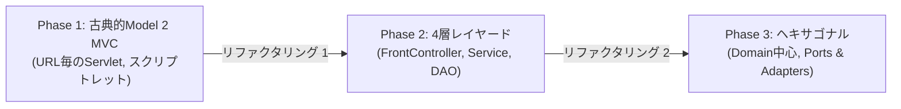

# リファクタリング変遷と設計発展の記録
## 06. リファクタリング提案・変遷書

### 1. はじめに

本ドキュメントは、本システムが古典的な「Servlet/JSP（Model 2 MVC）」からスタートし、どのような課題を経て「FrontController + 4層レイヤード」、さらには「ヘキサゴナル／クリーンアーキテクチャ（Ports & Adapters）」へと設計を進化させたのか、そのリファクタリングの歴史と設計判断の根拠を記録するものです。

---

## 2. 3段階のアーキテクチャ進化

---

## 3. Phase 1 から Phase 2 へのリファクタリング（基盤の標準化）

### 3.1 顕在化した課題
1. **URLごとにServletが乱立**: `ShainList`Servlet, `ShainInsert`Servletなど画面ごとにServletが存在し、文字コード設定やセッションチェックが重複。
2. **スクリプトレット（`<% %>`）の氾濫**: JSP内にJavaコードが混在し、保守性と可読性が著しく低下。
3. **トランザクション管理の不備**: 複数テーブルの更新時にConnectionのコミット/ロールバック箇所が定まらず、整合性維持が困難。

### 3.2 実施したリファクタリング
- **FrontController + Commandパターン導入**:
  - 全リクエストを `FrontController` で受け付け、URLに応じた `Action` クラスをディスパッチ。
- **JSTL / EL式への完全移行**:
  - JSPからスクリプトレットを全廃し、`<c:forEach>` や `${shain.name}` による描画に刷新。
- **TransactionManagerの導入**:
  - 複数DAO呼び出しを `TransactionManager.execute(...)` 内でラップし、安全な自動コミット/ロールバックを実現。
- **非同期通信（Fetch API + JSON Action）の導入**:
  - 画面全体を再読み込みせず、勤怠データの一部を動的更新する `controller.api` を新設。

---

## 4. Phase 2 から Phase 3 へのリファクタリング（ヘキサゴナル移行）

4層レイヤード（Action → Service → DAO）の導入により保守性は向上したものの、システム規模の拡大に伴い新たな課題が生じました。

### 4.1 4層レイヤードで直面した課題
1. **Fat Service化**: 入力値チェック・業務計算・DB呼び出し・トランザクション制御がServiceに一極集中。
2. **データベース中心の依存関係**: ServiceがDAOのテーブル構造やSQLに強く依存し、DBの変更が業務ロジック全域に波及。
3. **単体テストの困難性**: 複雑なSES精算計算や36協定判定を検証するために、常にDB接続やTomcat起動が必要となり、テスト実行が重く遅い。

### 4.2 ヘキサゴナル／クリーンアーキテクチャの適用
これらの根本原因である「データベースへの依存」を断ち切るため、**Ports and Adapters（ヘキサゴナルアーキテクチャ）** を採用しました。

| 課題 | 適用した解決パターン | 実装コンポーネント |
| :--- | :--- | :--- |
| **業務ロジックの肥大化** | ドメインモデルへの責務移譲（自己防衛ドメイン） | `domain.contract.SettlementService` `domain.compliance.Article36ComplianceService` |
| **DBへの強結合** | 依存性逆転の原則 (DIP) によるポート分離 | Outbound Port: `AttendanceRepository` Driven Adapter: `JdbcAttendanceRepository` |
| **テストの遅さ** | DB非依存の純粋POJO単体テスト | `domain` パッケージに対するミリ秒単位のJUnit 5テスト |

---

## 5. リファクタリングによる効果

1. **ビジネスルールの完全な独立**:
   - SES契約の精算幅判定や36協定の残業上限チェックなどの最重要ルールが、DBやフレームワークから100%独立。仕様変更時の修正箇所がドメイン層のみに限定。
2. **テスト自動化の劇的加速**:
   - DBを起動することなく、ミリ秒単位で精算・労基コンプライアンスの境界値テスト（JUnit 5）を網羅可能に。
3. **安全な段階的移行の実績**:
   - 既存の社員管理（`ShainService`, `ShainDao`）を安定稼働させたまま、新機能（SES勤怠・週報・精算）をクリーンアーキテクチャ基盤上で安全に拡張。
