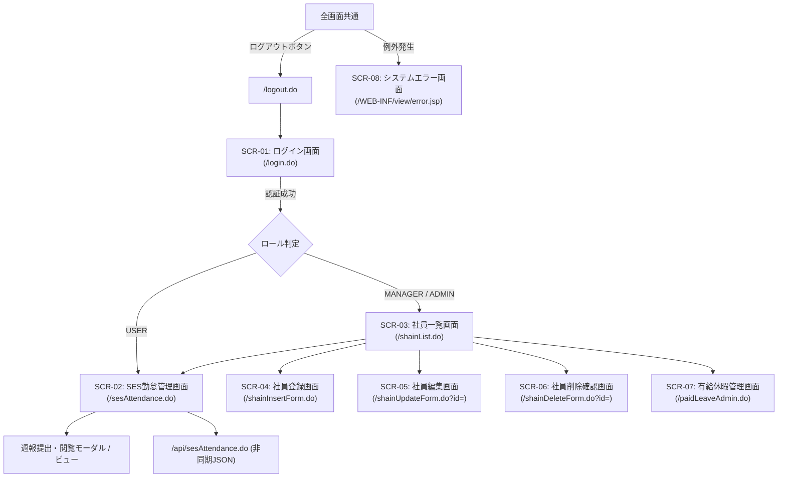

# SES勤怠管理・勤務報告書システム 画面・UI設計書

## 1. UI/UXデザインシステムと共通仕様

### 1.1 デザインコンセプト
- **クリーン＆データドリブン**: Tailwind CSSを全面採用し、余計な装飾を排した直感的なカードUIとテーブルレイアウトを提供。
- **ゼロリロード（部分更新）**: 毎日の勤怠保存や月間テンプレート適用時、画面全体のリロードを行わず、Fetch APIを用いた部分再描画によりネイティブアプリ並みの操作感を実現。
- **カラーパレットと状態表現**:
  - メインブランドカラー: `indigo-600` (`#4F46E5`)
  - 成功・正常ステータス: `emerald-600` (`#059669`) - 36協定 NORMAL、精算幅内
  - 警告ステータス: `amber-500` (`#F59E0B`) - 36協定 WARNING、有給未消化警告
  - 危険・超過ステータス: `red-600` (`#DC2626`) - 36協定 DANGER/VIOLATION、控除/超過発生
  - 背景色: `slate-50` (`#F8FAFC`) / テーブルヘッダ: `slate-100` (`#F1F5F9`)

---

## 2. 全体画面遷移図



---

## 3. 全画面レイアウト詳細仕様

### 3.1 SCR-01: ログイン画面 (`WEB-INF/view/login.jsp`)
- **URL**: `/login.do` / POST: `/loginExecute.do`
- **目的**: 社員ID・パスワードによるシステム認証。

```text
┌────────────────────────────────────────────────────────┐
│                      Dev-lab システム                  │
│                [ SES勤怠・勤務報告書システム ]         │
│ ┌────────────────────────────────────────────────────┐ │
│ │  社員ID (数値)                                     │ │
│ │  [ 1001                                          ] │ │
│ │  パスワード                                        │ │
│ │  [ ••••••••••                                    ] │ │
│ │                                                    │ │
│ │  [ ログイン (bg-indigo-600) ]                      │ │
│ └────────────────────────────────────────────────────┘ │
│ ※ エラー時: [⚠️ 社員IDまたはパスワードが正しくありません] (赤字)│
└────────────────────────────────────────────────────────┘
```
- **主要要素**:
  - `input[name="username"]`: 社員ID入力欄（type="text", inputmode="numeric"）
  - `input[name="password"]`: パスワード入力欄（type="password"）
  - エラーメッセージ領域: `<c:if test="${not empty errorMessage}">` でアラート表示。

---

### 3.2 SCR-02: SES勤怠管理画面 (`WEB-INF/view/ses_attendance.jsp`)
- **URL**: `/sesAttendance.do` / API: `/api/sesAttendance.do`
- **目的**: 月間カレンダー勤怠入力、契約精算幅リアルタイム監視、36協定アラート表示。

```text
┌────────────────────────────────────────────────────────────────────────┐
│ Dev-lab SES勤怠管理     [ 2026年 10月 ▼ ]   山田 太郎 (一般) [ログアウト]│
├────────────────────────────────────────────────────────────────────────┤
│ ■ 月次稼働サマリー & SES精算ステータス                                  │
│ ┌──────────────┬──────────────┬──────────────┬──────────────┐         │
│ │ ① 総実労働時間│ ② 契約精算幅 │ ③ 精算ステータス│ ④ 36協定警告 │         │
│ │   168.0 h    │ 140.0-180.0h │ [基準内 ¥0]  │ [NORMAL 良好]│         │
│ │ (直接 160h)  │              │              │ (当月残業8.0h│         │
│ └──────────────┴──────────────┴──────────────┴──────────────┘         │
│                                                                        │
│ [⚡ 月間テンプレート適用 (平日に09:00-18:00一括)]   [📝 週報を作成・確認] │
├────────────────────────────────────────────────────────────────────────┤
│ ■ 2026年10月 勤怠入力カレンダー                                        │
│ ┌───┬──┬─────┬─────┬─────┬─────┬────┬────────┬────────┬──────┬────┐  │
│ │日付│曜│始業 │終業 │休憩 │中抜 │実働│区分    │作業    │備考  │保存│  │
│ ├───┼──┼─────┼─────┼─────┼─────┼────┼────────┼────────┼──────┼────┤  │
│ │10/1│木│09:00│18:00│ 60m │  0m │8.0h│通常勤務│直:8.0h │設計  │[済]│  │
│ │10/2│金│09:00│20:00│ 60m │  0m │10.0│通常勤務│直:10.0h│実装  │[済]│  │
│ │10/3│土│--:--│--:--│  0m │  0m │0.0h│所定休日│--      │      │[済]│  │
│ │10/4│日│--:--│--:--│  0m │  0m │0.0h│法定休日│--      │      │[済]│  │
│ │10/5│月│09:00│18:00│ 60m │ 60m │7.0h│通常勤務│直:7.0h │通院  │[保]│  │
│ └───┴──┴─────┴─────┴─────┴─────┴────┴────────┴────────┴──────┴────┘  │
└────────────────────────────────────────────────────────────────────────┘
```
- **主要コンポーネント**:
  1. **サマリーカード領域**:
     - `id="totalWorkHours"`: 総実労働時間（時間単位小数点1桁）
     - `id="settlementBadge"`: 精算ステータスバッジ（`WITHIN_RANGE`: 緑, `DEDUCTION`: 黄, `OVERTIME`: 青）
     - `id="complianceBadge"`: 36協定バッジ（`NORMAL`: 緑, `WARNING`: 黄, `DANGER`: オレンジ, `VIOLATION`: 赤点滅）
  2. **カレンダー行 (Row)**:
     - 各行に `data-work-date="2026-10-01"` 属性を付与。
     - 時刻入力: HTML5 `<input type="time">`。
     - 中抜け休憩: `<input type="number" min="0" step="15">`（分単位）。
     - 保存ボタン: クリック時に該当行のみをJSON化して非同期送信。

---

### 3.3 SCR-03: 社員一覧画面 (`WEB-INF/view/shainlist.jsp`)
- **URL**: `/shainList.do`
- **目的**: 全社員の属性、役職、有給休暇残日数の一覧表示および各管理画面への導線。

```text
┌────────────────────────────────────────────────────────────────────────┐
│ 社員一覧コンソール                              管理者 鈴木 [ログアウト]│
├────────────────────────────────────────────────────────────────────────┤
│ [➕ 新規社員登録]     [🌴 有給休暇管理]     [📅 勤怠入力画面へ]         │
├────────────────────────────────────────────────────────────────────────┤
│ ■ 社員一覧 (全 15 件)                                                  │
│ ┌──────┬──────────┬──────────┬────┬────┬──────┬──────┬─────────┐   │
│ │社員ID│氏名      │フリガナ  │入社│性別│役職  │有給残│操作     │   │
│ ├──────┼──────────┼──────────┼────┼────┼──────┼──────┼─────────┤   │
│ │1001  │山田 太郎 │ヤマダタロウ│2020│男  │課長  │ 18日 │[編集][削]│   │
│ │1002  │佐藤 花子 │サトウハナコ│2023│女  │一般  │ 11日 │[編集][削]│   │
│ └──────┴──────────┴──────────┴────┴────┴──────┴──────┴─────────┘   │
└────────────────────────────────────────────────────────────────────────┘
```

---

### 3.4 SCR-04〜06: 社員登録・編集・削除画面
- **SCR-04 (`shaininsert.jsp`)**:
  - 入力項目: 社員ID、氏名、カナ、入社年、性別ラジオ、役職セレクト、初期パスワード。
  - バリデーション: ID重複、必須チェックをクライアントJSおよびサーバーAction双方で実施。
- **SCR-05 (`shainupdate.jsp`)**:
  - 社員IDは読み取り専用（`readonly`）。氏名、役職、有給残日数を変更可能。
- **SCR-06 (`shaindelete.jsp`)**:
  - 削除対象社員の情報を表示し、「本当に削除しますか？」の警告メッセージと赤色削除ボタンを配置。

---

### 3.5 SCR-07: 有給休暇管理画面 (`WEB-INF/view/paid_leave_admin.jsp`)
- **URL**: `/paidLeaveAdmin.do`
- **目的**: 勤続年数別付与ルールマスタの確認および全社員への有給一括付与バッチ実行。

```text
┌────────────────────────────────────────────────────────────────────────┐
│ 有給休暇管理コンソール                                [社員一覧に戻る] │
├────────────────────────────────────────────────────────────────────────┤
│ ■ 法定有給付与ルール (基準テーブル)                                    │
│ ┌──────────────┬──────┬──────┬──────┬──────┬──────┬──────┬──────┐    │
│ │勤続年数      │ 0年  │ 1年  │ 2年  │ 3年  │ 4年  │ 5年  │ 6年〜│    │
│ │付与日数      │ 10日 │ 11日 │ 12日 │ 14日 │ 16日 │ 18日 │ 20日 │    │
│ └──────────────┴──────┴──────┴──────┴──────┴──────┴──────┴──────┘    │
│                                                                        │
│ [📢 全社員に当年分の有給を一括付与する (確認ダイアログ表示)]            │
├────────────────────────────────────────────────────────────────────────┤
│ ■ 社員別消化状況・年5日取得義務監査                                    │
│ ┌──────┬──────────┬────────┬────────┬──────────┬─────────────────┐     │
│ │社員ID│氏名      │入社年  │勤続年数│有給残日数│年5日取得進捗    │     │
│ ├──────┼──────────┼────────┼────────┼──────────┼─────────────────┤     │
│ │1001  │山田 太郎 │2020年  │ 6年    │ 18日     │ [達成: 6日消化] │     │
│ │1002  │佐藤 花子 │2023年  │ 3年    │  4日     │ [⚠️ 警告: 1日消化]│     │
│ └──────┴──────────┴────────┴────────┴──────────┴─────────────────┘     │
└────────────────────────────────────────────────────────────────────────┘
```
- 一括付与ボタンクリック時、`confirm("全社員に対して勤続年数に応じた有給休暇を付与します。よろしいですか？")` を表示し、誤操作を防止。

---

## 4. フロントエンドJavaScript仕様 (`style.js` / 非同期通信)

### 4.1 非同期保存イベント処理
```javascript
async function saveAttendanceRow(rowElement) {
    const payload = {
        workDate: rowElement.dataset.workDate,
        startTime: rowElement.querySelector('.start-time').value,
        endTime: rowElement.querySelector('.end-time').value,
        breakMinutes: parseInt(rowElement.querySelector('.break-min').value) || 0,
        middleBreakMinutes: parseInt(rowElement.querySelector('.mid-break-min').value) || 0,
        abstractId: parseInt(rowElement.querySelector('.abstract-select').value),
        remarks: rowElement.querySelector('.remarks-input').value
    };

    const response = await fetch('/webapp2/api/sesAttendance.do', {
        method: 'POST',
        headers: { 'Content-Type': 'application/json' },
        body: JSON.stringify(payload)
    });

    if (response.ok) {
        const result = await response.json();
        updateSummaryCards(result.summary);
        markRowSaved(rowElement);
    } else {
        alert('保存に失敗しました。');
    }
}
```
