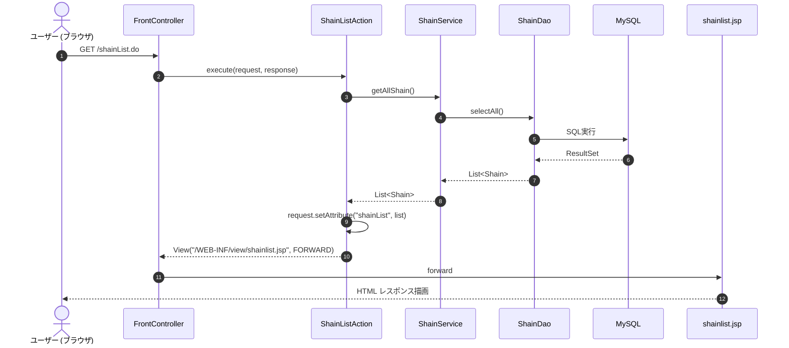
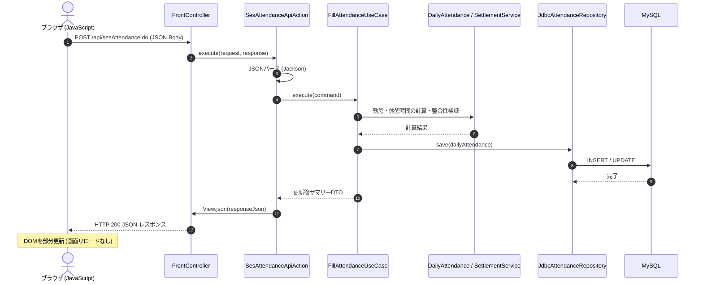

# 新アーキテクチャ設計書
## 07. 新アーキテクチャ設計書（ヘキサゴナル / クリーンアーキテクチャ）

### 1. はじめに

#### 1.1 目的
本ドキュメントは、本システムに採用されている「ヘキサゴナル／クリーンアーキテクチャ（Ports and Adapters）」および「FrontController + Commandパターン」の構造、レイヤー責務、コンポーネント設計を定義するものです。

フレームワーク（Spring等）に依存せず、Java標準仕様（Java 11 / Servlet 4.0）のみを用いて、保守性・テスト容易性・拡張性に優れたアーキテクチャを実現します。

---

## 2. 全体アーキテクチャ構造

システムの中心に「ドメインモデル（業務ルール）」を配置し、プレゼンテーション（Web/JSP）やインフラストラクチャ（JDBC/MySQL）を交換可能なアダプターとして外郭に配置します。

```mermaid
flowchart TD
    subgraph DrivingAdapter [1. プレゼンテーション層 (Driving Adapter)]
        FC[FrontController]
        Action[Action (Command)]
        ApiAction[ApiAction (JSON)]
        View[JSP View / JSON View]
        FC --> Action
        FC --> ApiAction
        Action --> View
    end

    subgraph Core [アプリケーションコア (Hexagon)]
        subgraph UseCaseLayer [2. ユースケース層 (Inbound Port)]
            UC[UseCase / Service]
        end

        subgraph DomainLayer [3. ドメイン層 (Domain Model)]
            Entity[Domain Entities]
            DS[Domain Services]
            PortIF[Repository Interface (Outbound Port)]
            Entity --> DS
        end
        UC --> Entity
        UC --> DS
        UC --> PortIF
    end

    subgraph DrivenAdapter [4. インフラストラクチャ層 (Driven Adapter)]
        RepoImpl[JdbcRepository / DAO]
        TM[TransactionManager]
        SQL[外部SQLファイル]
        DB[(MySQL 8.0)]
        RepoImpl -.->|implements| PortIF
        RepoImpl --> SQL
        RepoImpl --> DB
        TM --> DB
        UC --> TM
    end

    Action --> UC
    ApiAction --> UC
```

### レイヤー間の依存性ルール（Dependency Inversion Principle）
- **外側から内側への単方向依存**: 上位層（Presentation/Infrastructure）は内側（UseCase/Domain）に依存できますが、内側は外側の技術（Servlet, JDBC, JSP等）を一切知りません。
- **依存性逆転**: ドメイン層が永続化インターフェース（`AttendanceRepository` 等のOutbound Port）を定義し、インフラ層の `JdbcAttendanceRepository` がそれを実装します。

---

## 3. レイヤー構成とパッケージ配置

本プロジェクトの実装パッケージ構造（`src/main/java` 直下）は以下の通りです。

```text
src/main/java/
├── controller/                   # [プレゼンテーション層]
│   ├── FrontController.java      # *.doを一元受付けするサーブレット
│   ├── Action.java               # コマンドインターフェース
│   ├── View.java                 # 遷移先情報保持クラス
│   ├── action/                   # 画面遷移系Action (ShainListAction, SesAttendanceAction等)
│   └── api/                      # 非同期JSON Action (SesAttendanceApiAction)
├── usecase/                      # [ユースケース層]
│   ├── attendance/               # ApplyMonthlyTemplateUseCase, FillAttendanceUseCase
│   ├── contract/                 # CalculateSettlementUseCase
│   ├── shain/                    # ShainService, LeaveService, ClassmasterService
│   └── weeklyreport/             # SubmitWeeklyReportUseCase, ReviewWeeklyReportUseCase
├── domain/                       # [ドメイン層]
│   ├── attendance/               # DailyAttendance, WorkTimeSegment, AttendanceRepository (Port)
│   ├── auth/                     # UserSession, UserRole, AuthRepository (Port)
│   ├── compliance/               # Article36ComplianceService, PaidLeaveComplianceService
│   ├── contract/                 # ProjectContract, SettlementService, SettlementResult
│   ├── shain/                    # Shain, LeaveGrantRule, Classmaster
│   └── weeklyreport/             # WeeklyReport, ReportStatus, WeeklyReportRepository (Port)
├── infrastructure/               # [インフラストラクチャ層]
│   ├── db/                       # TransactionManager, ConnectionBase, TransactionalOperation
│   └── persistence/              # JdbcAttendanceRepository, ShainDao, LeaveDao等
└── common/                       # [共通層] MyUtil (共通ユーティリティ)
```

---

## 4. リクエスト処理フロー

### 4.1 画面遷移リクエスト (HTML / JSP)



### 4.2 非同期更新リクエスト (Fetch API / JSON)



---

## 5. 主要設計パターンと実装規約

### 5.1 トランザクション管理設計 (`TransactionManager`)
複数のDB更新を伴うユースケースでは、`TransactionManager` を用いて接続取得・コミット・ロールバックをカプセル化します。

```java
TransactionManager.execute(con -> {
    shainDao.insert(con, shain);
    authDao.insertLogin(con, login);
    return null;
});
```
- 正常終了時は自動 `con.commit()`。
- 例外発生時は自動 `con.rollback()` が行われ、呼び出し元へ安全に例外を再スロー。

### 5.2 ドメインの自己完結性（自己防衛ドメイン）
- ドメインモデルは外部の不正なデータで不正な状態にならないよう、バリデーションと計算を内部で完結させます。
- 例: `SettlementService` は「実働時間」「下限」「上限」「単価」を受け取り、自身の計算ルールで確実に精算額とステータスを返却します（フレームワークやDBの都合が混入しない）。

### 5.3 テスト設計
- ドメイン層のクラスは外部リソース（DB・Servletコンテキスト）を一切要求しないため、JUnit 5によりミリ秒単位で徹底的な単体テストを実行可能です。
