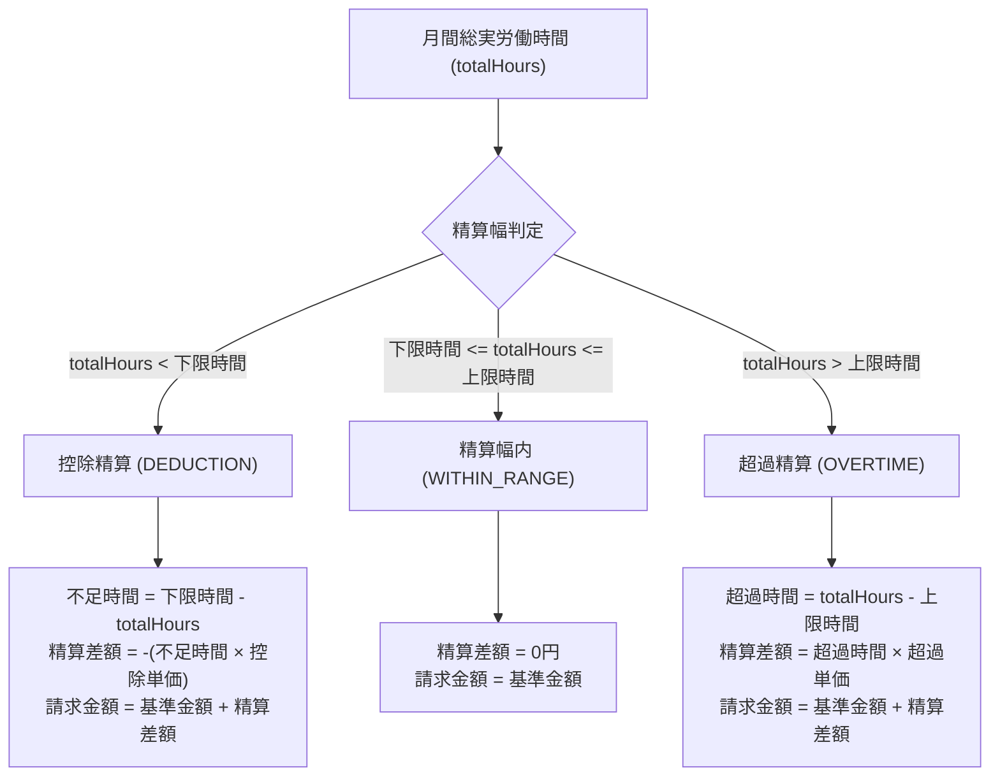

# SES勤怠管理・勤務報告書システム ドメイン業務ロジック詳細設計書

## 1. ドメインロジックの基本方針

本システムにおける全ての業務計算・法的判定・整合性検証は、データベースやWebコンテキストから完全に隔離された **「ドメイン層（`domain.*`）」** の純粋なJavaクラス（POJO）内で完結します。

### 自己防衛ドメイン（Self-Defending Domain）原則
1. **不正な状態の生成阻止**: エンティティのコンストラクタおよびセッターメソッドにおいて、時間順序の破綻や負の時間などの不正値を検知した場合は `IllegalArgumentException` をスローし、不正オブジェクトの存在を許さない。
2. **副作用のない計算**: ドメインサービス（`SettlementService`, `Article36ComplianceService` 等）は状態を持たず（Stateless）、引数として受け取ったドメインモデルから計算結果（イミュータブルなValue Object）を返却する。
3. **ミリ秒単位の完全単体テスト**: 外部依存（DBやServlet）がないため、すべての境界値パターンを JUnit 5 で網羅する。

---

## 2. 日次勤怠・時間計算ロジック (`DailyAttendance`)

### 2.1 時間計算アルゴリズム
1日における実働時間・残業時間は以下の計算順序で算出する。

```text
[出勤時刻: 09:00] ─────────────────────── [退勤時刻: 19:30]  (滞在時間: 10時間30分 = 630分)
    │                                          │
    ├── [固定休憩時間: 60分] 控除               │
    ├── [中抜け時間: 30分]   控除               │
    ▼                                          ▼
[実労働時間] = 630分 - 60分 - 30分 = 540分 (9.0時間)
    │
    ├── [法定基準労働時間: 8.0時間 = 480分]
    ▼
[法定時間外残業時間] = MAX(0, 540分 - 480分) = 60分 (1.0時間)
```

### 2.2 休暇・休日種別ごとの挙動規則
| 区分 (`LeaveType`) | 実労働時間 | 法定外残業 | 労働日カウント | 有給消化カウント | 備考 |
| :--- | :---: | :---: | :---: | :---: | :--- |
| `NORMAL` (通常出勤) | 計算値 | 計算値 | 1日 | 0日 | 通常の稼働日 |
| `PAID_LEAVE` (全休) | 0分 | 0分 | 0日 | 1.0日 | 所定労働時間を勤務したものとみなす |
| `SPECIAL` (特別休暇)| 0分 | 0分 | 0日 | 0日 | 慶弔等の有給休暇 |
| `ABSENCE` (欠勤) | 0分 | 0分 | 0日 | 0日 | 給与控除対象 |
| `LEGAL_HOLIDAY` (法休)| 計算値 | 計算値(休日割増)| 0日 | 0日 | 日曜等の法定休日出勤 |
| `PRESCRIBED_HOLIDAY`| 計算値 | 計算値 | 0日 | 0日 | 土曜等の所定休日出勤 |

---

## 3. SES契約精算計算ロジック (`SettlementService`)

### 3.1 契約モデル仕様
- `billingLowerLimitHours`: 精算下限時間（例: 140.0h）
- `billingUpperLimitHours`: 精算上限時間（例: 180.0h）
- `standardAmount`: 基準契約金額（例: 650,000円）
- `middleHours`: 中間基準時間 = `(下限時間 + 上限時間) ÷ 2`（例: 160.0h）
- `overtimeUnitPrice`: 超過単価（指定がない場合: `standardAmount ÷ 上限時間`、四捨五入）
- `deductionUnitPrice`: 控除単価（指定がない場合: `standardAmount ÷ 下限時間`、切り捨て）

### 3.2 精算判定および計算アルゴリズム



### 3.3 計算例と境界値
- 条件: 基準金額 600,000円、幅 140.0h〜180.0h、超過単価 3,330円/h、控除単価 4,280円/h
  1. **ケースA (160.0h稼働)**: `WITHIN_RANGE` → 精算差額 0円、請求 600,000円
  2. **ケースB (140.0hジャスト稼働)**: `WITHIN_RANGE` → 境界値含むため控除なし（請求 600,000円）
  3. **ケースC (180.0hジャスト稼働)**: `WITHIN_RANGE` → 境界値含むため超過なし（請求 600,000円）
  4. **ケースD (135.5h稼働)**: `DEDUCTION` → 不足 4.5h × 4,280円 = 19,260円控除 → 請求 580,740円
  5. **ケースE (192.5h稼働)**: `OVERTIME` → 超過 12.5h × 3,330円 = 41,625円加算 → 請求 641,625円

---

## 4. 労基法第36条コンプライアンス判定ロジック (`Article36ComplianceService`)

### 4.1 法定時間外残業時間の集計
当月の全日における `DailyAttendance.getOvertimeMinutes()` を合算し、時間単位（小数第1位）へ換算。

### 4.2 4段階の判定基準
```java
public OvertimeLevel evaluateMonthlyOvertime(BigDecimal overtimeHours) {
    if (overtimeHours.compareTo(new BigDecimal("30.0")) < 0) {
        return OvertimeLevel.NORMAL;      // 0h以上 30h未満
    } else if (overtimeHours.compareTo(new BigDecimal("45.0")) < 0) {
        return OvertimeLevel.WARNING;     // 30h以上 45h未満 (36協定通常限度接近)
    } else if (overtimeHours.compareTo(new BigDecimal("80.0")) < 0) {
        return OvertimeLevel.DANGER;      // 45h以上 80h未満 (特別条項発動域)
    } else {
        return OvertimeLevel.VIOLATION;   // 80h以上 (過労死ライン・違法リスク)
    }
}
```

---

## 5. 年5日有給休暇取得義務判定ロジック (`PaidLeaveComplianceService`)

### 5.1 判定アルゴリズム
- 労働基準法第39条第7項に基づき、年10日以上の有給が付与される労働者に対する年5日の消化状況を追跡。
- 基準日（例: 4月1日）からの経過月数を算出：
  - **経過月数 6ヶ月時点**: 取得日数が 2.0日未満の場合 → `WARNING`（ペース遅延警告）
  - **経過月数 9ヶ月時点**: 取得日数が 3.5日未満の場合 → `DANGER`（未達リスク高）
  - **経過月数 12ヶ月時点**: 取得日数が 5.0日未満の場合 → `VIOLATION`（労基法違反）

---

## 6. 勤続年数別有給付与ロジック (`LeaveGrantRule`, `LeaveService`)

### 6.1 付与日数算定テーブル
```text
勤続年数 0年 (入社時)  : 10日付与
勤続年数 1年 (1年6ヶ月): 11日付与
勤続年数 2年 (2年6ヶ月): 12日付与
勤続年数 3年 (3年6ヶ月): 14日付与
勤続年数 4年 (4年6ヶ月): 16日付与
勤続年数 5年 (5年6ヶ月): 18日付与
勤続年数 6年以上       : 20日付与 (法定上限)
```

### 6.2 保有上限丸め処理
- 労働基準法上の有給休暇有効期限は2年間であるため、最大保有日数は「前年度繰越分(最大20日) ＋ 当年度付与分(最大20日) ＝ 40日」。
- `付与後残日数 = MIN(40, 現在保有日数 + 付与日数)`。
