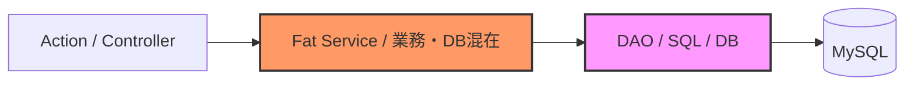

# 09. MVCからの設計転換ガイド

> **対象読者**: クラシックなMVC（Servlet/JSP、Struts、Spring MVC等）の経験を持つ開発メンバー  
> **目的**: 従来のMVCパラダイムから「ドメイン中心アーキテクチャ（クリーン／ヘキサゴナル）」への思考の転換と、現場での実践勘所を掴む  
> **ドキュメント番号**: DOC-09

---

## 1. なぜ従来のMVCから設計を転換したのか？

従来の「Controller（Action） → Service → DAO」によるMVC／レイヤード設計は直感的で、初期の単純なCRUD開発には極めて適していました。
しかし、本システムのように**SES特有の複雑な業務ルール**（客先精算幅、36協定アラート、中抜け休憩、週報多層承認など）が追加されるにつれ、以下の限界に直面しました。



### 従来のMVCで起きていた3大課題

1. **データベース中心の依存関係**:
   - ServiceがDAOのSQLやテーブル構造に強く引きずられ、テーブル都合（カラム追加やNULL許容など）が業務計算ロジックに直接侵入していました。
2. **Fat Service と 貧血JavaBeans（Anemic Model）**:
   - JavaBeansはgetter/setterだけの受動的な入れ物になり、あらゆる入力検証や計算、DB呼び出しがServiceに集中して肥大化。実労働時間と内訳が合わないなどの不正データが容易に混入しました。
3. **テストの重さと遅さ**:
   - 業務ルールを検証したいだけでも、MySQL接続やTomcatコンテキストが必要となり、単体テストが書きにくく「テストコードが存在しない」状態に陥っていました。

### 転換によって得られた果実

- **業務ルールの独立**: 純粋なビジネスルールがDB・フレームワーク（Servlet/JDBC）から完全隔離。
- **超高速な単体テスト**: DB接続・Tomcat起動不要で、全20件のJUnitテストが**約0.8秒**で完了。
- **外部技術のプラグイン化**: DB接続先やUIの都合が変わっても、中核の業務ロジックには1行も影響しません。

---

## 2. 直感で掴む設計思想：任天堂Switchとカセット

ヘキサゴナル／クリーンアーキテクチャの本質は、**「ゲーム機本体とカセット」**の関係です。

```
┌────────────────────────────────────────────────────────┐
│                   任天堂Switch本体                      │
│        【ドメイン／ユースケース（中核のゲームロジック）】       │
│                                                        │
│   ・Marioのジャンプ力や当たり判定（純粋なルール）               │
│   ・外部が液晶画面かテレビか、コントローラーが何かは知らない    │
└───────────────▲────────────────────────▲───────────────┘
                │                        │
       【端子: Inbound Port】     【端子: Outbound Port】
                │                        │
┌───────────────┴────────┐      ┌────────┴───────────────┐
│     Joy-Con / プロコン   │      │   ドック / 有機EL / TV   │
│   【Driving Adapter】   │      │    【Driven Adapter】   │
│ (Web Action / REST API)│      │  (MySQL / インメモインスタブ)│
└────────────────────────┘      └────────────────────────┘
```

- **本体（コア）**: ビジネスルールそのもの。外部の都合を一切知りません。
- **入力側（Joy-Con）**: Webリクエストを受け取り、本体のルールを呼び出すプラグイン。
- **出力側（TV画面/DB）**: コアが宣言した端子（インターフェース）に沿ってデータを保存・表示するプラグイン。

> **💡 依存性の逆転（DIP）**:
> 依存の矢印は必ず「外側から中心」へ向かいます。中核の業務ルールはMySQLやJDBCに依存せず、外側のDAOが中核のインターフェースを実装します。

---

## 3. 「MVCのこれ、新アーキテクチャでどこ？」完全対応マップ

これまでのMVCの知識と新アーキテクチャの対応関係は以下の通りです。

| 従来のMVC要素 | 新アーキテクチャでの名称 | 主な責務・役割 | 本プロジェクトでの配置 |
| :--- | :--- | :--- | :--- |
| **Action / Controller** | **Web Adapter (Controller)** | HTTP受付、パラメータ検証、UseCase呼び出し、画面遷移/JSON返却 | `controller/action/`<br>`controller/api/` |
| **Service (業務手順)** | **UseCase Service** | 業務処理シナリオの進行役。ドメインモデルを操作してリポジトリに保存 | `usecase/attendance/`<br>`usecase/weeklyreport/` |
| **Service内に書かれていた計算・判定** | **Domain Model / Service** | 純粋な計算・バリデーション・状態遷移ガード（外部依存ゼロ） | `domain/attendance/`<br>`domain/contract/`<br>`domain/compliance/` |
| **JavaBean (getter/setterのみ)** | **Entity (自己防衛エンティティ)** | 自身の不変条件（整合性）を自ら検証し、不正データを拒絶するオブジェクト | `domain/attendance/DailyAttendance.java` 等 |
| **DAO (インターフェース & 実装)** | **Repository (Port & Adapter)** | コア層が宣言したインターフェースを、JDBC/SQLで具象実装 | `infrastructure/persistence/` |

---

## 4. コード対比で見る「思考の転換」（Before / After）

### 【Before】従来のMVC（Action / Serviceにロジックがむき出し）

```java
// ServiceやActionの中で直接DBアクセスと業務計算が混ざっている
public class KintaiService {
    private KintaiDao dao = new KintaiDao();

    public void update(KintaiBean bean) throws Exception {
        // 業務ルールがService内に散乱
        int total = calc(bean.getStartTime(), bean.getEndTime());
        if (total != (bean.getDirect() + bean.getIndirect())) {
            throw new Exception("内訳不一致");
        }
        dao.update(bean); // DBに直接依存（テスト時はDB必須）
    }
}
```
- **問題点**: `KintaiBean` に誤った数値をセットしたまま別の場所で使えてしまう。テストに必ずDBが必要。

### 【After】新アーキテクチャ（自己防衛エンティティ ＋ 依存性逆転）

#### 1. ドメイン層：自ら正しさを防衛する（`domain/attendance/DailyAttendance.java`）
```java
public class DailyAttendance {
    public void fillAttendance(LocalTime start, LocalTime end, int breakMin, List<WorkTimeSegment> segments) {
        if (this.isLocked) {
            throw new IllegalStateException("月次確定済のため変更できません");
        }
        this.startTime = start;
        this.endTime = end;
        this.breakMinutes = breakMin;
        this.segments = segments;

        // ★ エンティティ自らが不整合を拒絶！不正なデータはメモリ上に1秒も存在できない
        validateSegmentsIntegrity();
    }
}
```

#### 2. ユースケース層：手順の調停役（`usecase/attendance/FillAttendanceUseCase.java`）
```java
public class FillAttendanceUseCase {
    private final AttendanceRepository repository; // インターフェースに依存

    public DailyAttendance execute(FillAttendanceInput input) {
        DailyAttendance att = repository.findByDate(input.getStaffId(), input.getDate());
        att.fillAttendance(input.getStart(), input.getEnd(), input.getBreakMin(), input.getSegments());
        repository.save(att);
        return att; // 結果をそのまま返却
    }
}
```

---

## 5. 現場での現実的割り切り（教科書通りにやらない勇気）

クリーンアーキテクチャの理論を現場にそのまま持ち込むと、「クラス数が多すぎる」「Webフレームワークと合わない」という壁にぶつかります。本プロジェクトでは現場の実用性を重視し、以下の現実的な割り切りを採用しています。

### 割り切り1: 「Presenterは捨てて、戻り値で返す」
- 教科書的なクリーンアーキテクチャでは `Output Boundary` と `Presenter` を作りますが、WebアプリケーションではControllerが直接レスポンスを生成する方が自然です。
- したがって本プロジェクトでは、**UseCase Interactor が結果オブジェクト（DomainまたはDTO）をメソッドの戻り値として直接返す**形に割り切っています。

### 割り切り2: 「スタブ先行開発で即時テスト」
- DBのテーブル作成やSQLを待つ必要はありません。
- リポジトリのインターフェースに対して「メモリ上のMapで動くスタブ」を用意すれば、**DB接続前にすべての業務ロジックの単体テストを完成**させられます。

---

## 6. よくある疑問とFAQ（先輩エンジニアからの質問集）

### Q1. クラス数やインターフェースが増えて冗長ではないですか？
**A.** 初見ではファイル数が増えて見えますが、1ファイルあたりのコード量は大幅に減少し、責務が1つになります。結果として「どこを直せばいいか」の探索時間が短縮され、デグレの心配がなくなります。

### Q2. ドメインのEntityとDAOのテーブルBeanで似たクラスができるのはなぜ？
**A.** 「業務ルールの変更理由」と「データベースの変更理由（正規化やインデックス都合）」は全く異なるためです。分離しておくことで、テーブル定義を変更しても業務ルールが壊れなくなります。

### Q3. 新機能・改修時はどこから書き始めるべきですか？
**A.** 以下の順序で進めるのが鉄則です：
1. **Domain**: 純粋なJavaでビジネスルールと計算を書く（外部APIのimportは厳禁）。
2. **Domain Test**: JUnitでそのルールが100%正しく動くか検証する（所要時間数ミリ秒）。
3. **UseCase**: ユースケースを作成し、リポジトリのインターフェースを定義する。
4. **Adapter (Controller / JDBC)**: 最後に外側の画面やSQLを接続する。

---
*SES勤怠管理システム開発チーム / DOC-09*
