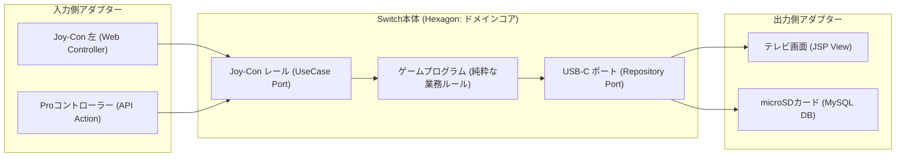

# SES勤怠管理・勤務報告書システム アーキテクチャ設計思想とMVC転換ガイド

## 1. はじめに：なぜ古典的MVC（Model 2）から脱却したのか？

Web開発の入門では、Servlet/JSPによる **「Model 2 MVC」**（Controller=Servlet, View=JSP, Model=JavaBeans/DAO）が広く教えられています。  
しかし、実務レベルの業務システムにおいて古典的MVCをそのまま運用し続けると、以下の3大アンチパターンが必然的に発生します。

### 1.1 古典的MVCの3大崩壊パターン
1. **Fat Controller**: Servlet内に「パラメータ解析」「セッション検証」「DB接続」「SQL呼び出し」「例外処理」「画面遷移」が混然一体となり、1クラスが1,000行を超えて改修不能になる。
2. **Fat Service / データベース中心主義**: Modelと一括りにされたServiceクラスが、DAOのSQLやテーブル構造に強く引きずられ、純粋なビジネスルールがSQL文字列やResultSetループの中に埋没する。
3. **テストの遅さと重さ**: 業務計算（例: SES精算や36協定判定）をテストするためだけに、毎回DB接続やTomcat起動が必要になり、自動テストが書かれなくなる。

本プロジェクトでは、Spring Bootなどの重量級フレームワークを使わない制約の中で、これらの課題を根本解決するために **「ヘキサゴナルアーキテクチャ（Ports and Adapters）」** を採用しました。

---

## 2. ヘキサゴナルアーキテクチャの核心：「Nintendo Switchの例え」

ヘキサゴナルアーキテクチャ（Ports and Adapters）の本質は、**「ゲーム機本体（ドメイン）とコントローラー・画面（アダプター）の分離」** です。



### 「ポート」と「アダプター」の役割
- **コア（Switch本体 / ドメイン）**: 『ゼルダ』や『マリオ』のゲームロジックそのもの。テレビの解像度やコントローラーのBluetoothプロトコルを知らない。
- **ポート（端子）**: レールやUSB-Cコネクタ。ゲーム機が「こういう形式で入出力してくれ」と定めたインターフェース。
- **アダプター（周辺機器）**: Webサーブレット、JSP、MySQL JDBCドライバなど。技術が変わっても（MySQLからPostgreSQLに変わっても、WebからCLIに変わっても）、本体のゲームロジックには一切手を加えずに差し替え可能。

---

## 3. MVCとヘキサゴナルの対応比較マップ

| MVCの要素 | 本アーキテクチャの配置 | 主なクラス・インターフェース | 責務の明確化 |
| :--- | :--- | :--- | :--- |
| **Controller** | **Driving Adapter** (プレゼンテーション層) | `FrontController`<br>`SesAttendanceAction`<br>`SesAttendanceApiAction` | HTTPリクエストの受け付け、パラメータのDTO変換、レスポンス形式（JSP/JSON）の決定のみ。 |
| **Model**<br>*(古典的MVCでは1つ)* | **① Inbound Port & UseCase** (ユースケース層) | `FillAttendanceUseCase`<br>`CalculateSettlementUseCase` | 業務ユースケースの実行手順制御、トランザクション境界の設定。 |
| | **② Domain Model** (ドメイン層コア) | `DailyAttendance`<br>`SettlementService`<br>`Article36ComplianceService` | **純粋な業務ルール・計算・コンプライアンス判定**。外部技術に100%依存しないPOJO。 |
| | **③ Outbound Port** (ドメイン層インターフェース) | `AttendanceRepository`<br>`ContractRepository` | 永続化や外部通信に必要な操作の仕様（抽象）を定義。 |
| | **④ Driven Adapter** (インフラストラクチャ層) | `JdbcAttendanceRepository`<br>`ShainDao`<br>`TransactionManager` | JDBC接続、外部SQLファイル実行、MySQLとのCRUD通信。 |
| **View** | **View Adapter** (プレゼンテーション層) | `WEB-INF/view/*.jsp`<br>`controller.View` | 描画専用。スクリプトレット（`<% %>`）は全面廃止し、JSTL/EL式を使用。 |

---

## 4. 実装コードの Before / After 比較

### 4.1 勤怠計算とDB更新の比較

#### 【Before】古典的MVC (Fat Service / DAO直接依存)
```java
// Serviceクラス内にSQL、パラメータ検証、計算が全部混ざる
public class KintaiService {
    public void updateKintai(HttpServletRequest req) throws SQLException {
        String start = req.getParameter("startTime");
        String end = req.getParameter("endTime");
        // 時間計算を手動でガリガリ書く
        int workMin = parse(end) - parse(start) - 60;
        
        // Serviceが直接Connectionを持ってSQLを実行
        Connection con = ConnectionBase.getConnection();
        String sql = "UPDATE kintai SET work_time = ? WHERE id = ?";
        PreparedStatement ps = con.prepareStatement(sql);
        ps.setInt(1, workMin);
        ps.executeUpdate();
        con.close();
    }
}
```
*問題点: Servletリクエストに依存しており単体テスト不可。Connectionの解放漏れリスク。DBが変わると計算ロジックごと壊れる。*

#### 【After】ヘキサゴナルアーキテクチャ (自己防衛ドメイン + ポート分離)
```java
// 1. ドメインモデル (純粋POJO・単体テスト可能)
public class DailyAttendance {
    public void calculateWorkTimes() {
        if (endTime.isBefore(startTime)) {
            throw new IllegalArgumentException("終業時刻は始業時刻より後である必要があります");
        }
        int totalMinutes = (int) Duration.between(startTime, endTime).toMinutes();
        this.actualWorkMinutes = Math.max(0, totalMinutes - breakMinutes - middleBreakMinutes);
        this.overtimeMinutes = Math.max(0, this.actualWorkMinutes - 480); // 8時間超
    }
}

// 2. ユースケース (Portを通じて操作・トランザクション保証)
public class FillAttendanceUseCase {
    private final AttendanceRepository repository; // Outbound Port

    public DailyAttendance execute(AttendanceCommand cmd) {
        DailyAttendance att = repository.find(cmd.getEmployeeId(), cmd.getWorkDate());
        att.updateTimes(cmd.getStart(), cmd.getEnd(), cmd.getBreak(), cmd.getMidBreak());
        att.calculateWorkTimes(); // ドメイン自身が計算
        
        repository.save(att); // アダプターがDBに保存
        return att;
    }
}
```
*改善点: `DailyAttendance` はDBやServletを全く知らず、JUnit 5でミリ秒単位で完全テスト可能。DBの保存処理はRepositoryアダプターに隠蔽。*

---

## 5. 設計転換に関するよくある質問 (FAQ)

### Q1. クラス数がMVCより増えて面倒ではないですか？
**A1.** 短期的なクラス数は増えますが、「どこに何が書いてあるか」が100%明確になります。バグが発生した際、計算ロジックの不具合なら `domain` を見ればよく、DBエラーなら `infrastructure` を見ればよいため、調査・修正時間は半分以下に激減します。

### Q2. ドメイン層からDAOを直接呼んではいけないのですか？
**A2.** 絶対にいけません（DIP違反）。ドメインがDAO（DB）を知ってしまうと、「テーブル構造が変わったら業務ルールも修正」「テスト時に毎回DB起動が必要」というMVCの悪夢に逆戻りします。ドメインはインターフェース（ポート）のみを定義し、具象DAOを呼び出してはいけません。
